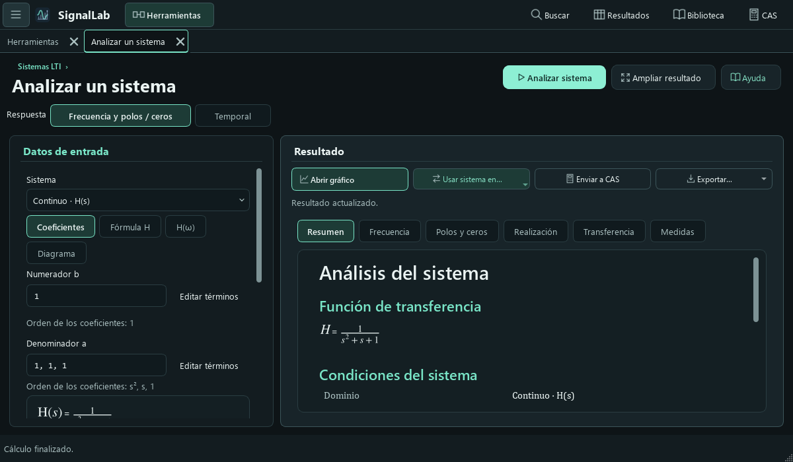

  

  <a href="https://github.com/Tincho1286/SignalLab-PC/releases/latest"><strong>Descargar</strong></a> ·
  <a href="docs/getting-started.md">Primeros pasos</a> ·
  <a href="docs/tools.md">Herramientas</a> ·
  <a href="docs/README.md">Documentación</a> ·
  <a href="docs/releases/README.md">Historial</a>

SignalLab PC es un laboratorio de escritorio para **Sistemas y Señales I/II y procesamiento digital de señales**. Podés calcular una transformada, diseñar un filtro o estudiar un sistema LTI con cálculo simbólico, simulación numérica e informes. Podés reutilizar los resultados en otras herramientas compatibles. La aplicación está disponible en español para Windows y Linux.

## Descargar SignalLab PC

**1.9.6 estable** · [Notas de la versión](docs/releases/v1.9.6.md) · [Código fuente y sumas SHA‑256](https://github.com/Tincho1286/SignalLab-PC/releases/tag/v1.9.6)

| Plataforma | Instalable | Portable |
| --- | --- | --- |
| Windows x64 | [Instalador .exe](https://github.com/Tincho1286/SignalLab-PC/releases/download/v1.9.6/SignalLab-PC-1.9.6-setup.exe) | [Ejecutable .exe](https://github.com/Tincho1286/SignalLab-PC/releases/download/v1.9.6/SignalLab-PC-1.9.6.exe) |
| Linux x86_64 | [Instalador .run](https://github.com/Tincho1286/SignalLab-PC/releases/download/v1.9.6/SignalLab-PC-1.9.6-linux-x86_64.run) | [Archivo .tar.gz](https://github.com/Tincho1286/SignalLab-PC/releases/download/v1.9.6/SignalLab-PC-1.9.6-linux-x86_64.tar.gz) |

Los cuatro paquetes incluyen Python y las dependencias. Si querés actualizar desde la aplicación, elegí el instalable y abrí **Ayuda → Buscar actualizaciones**. Para ejecutar SignalLab desde una carpeta, elegí el portable. [Requisitos e instrucciones](docs/installation.md) · [Canales de actualización](docs/installed-updates.md).

**1.9.9 preliminar** · Probá el rediseño del escritorio, las figuras y los flujos de reutilización. [Descargas para Windows y Linux](https://github.com/Tincho1286/SignalLab-PC/releases/tag/v1.9.9) · [Notas de la versión](docs/releases/v1.9.9.md).

  
   Análisis de un sistema continuo a partir de sus coeficientes.

## Herramientas

| Qué querés estudiar | Qué podés hacer |
| --- | --- |
| **Señales y operaciones** | Crear fórmulas, funciones por tramos, ventanas o registros. Calcular convolución, correlación, energía, potencia y RMS. |
| **Sistemas y filtros** | Obtener H(s) o H(z) de una fórmula, coeficientes o un diagrama de bloques. Ver respuestas, polos, ceros y retardo. Diseñar FIR e IIR, enventanar h[n] y definir filtros ideales por bandas. |
| **Transformadas y ecuaciones** | Calcular Fourier, Laplace y Z con las condiciones que correspondan. Obtener inversas y resolver ecuaciones diferenciales y en diferencias con condiciones iniciales. |
| **Muestreo y espectros** | Estudiar aliasing, reconstrucción, cambio de tasa y cuantización. Comparar DFT y DTFT, probar ventanas y analizar espectros con periodograma, Welch o STFT. |
| **CAS y señales aleatorias** | Operar con expresiones, supuestos y matrices. Generar registros aleatorios, comparar estadísticas y trabajar con modelos AR, MA y ARMA. |

Consultá el [catálogo detallado](docs/tools.md) o el alcance por materia para [Sistemas y Señales I/II](docs/scope/sys-i-ii.md) y [Señales Aleatorias](docs/scope/random-signals.md).

## Flujo de trabajo

1. Abrí una herramienta desde el catálogo o buscala con **Ctrl+K**. Cada herramienta tiene sus propias entradas. **F1** abre la ayuda del cálculo activo.
2. Presioná **Calcular** y leé el informe. Desde el mismo resultado podés abrir las figuras, consultar muestras con el cursor o comparar curvas.
3. Usá **Usar señal en…** o **Usar filtro en…** para continuar en otra herramienta. Desde **Resultados** podés exportar objetos e informes. **Archivo → Sesiones** guarda el trabajo para retomarlo después.

Por ejemplo, podés diseñar un FIR por tolerancias, revisar sus bandas y usar ese mismo filtro en una respuesta temporal. [Primeros pasos](docs/getting-started.md) · [Gráficos y mediciones](docs/cursors.md) · [Sesiones y formatos](docs/file-formats.md).

## Novedades de la 1.9.6

El motor algebraico conserva mejor el soporte de las señales y la región de convergencia al calcular transformadas. Las correcciones abarcan impulsos, integrales por tramos, secuencias desplazadas y medidas de energía y potencia.

Esta estable incorpora además las sesiones recuperables, el guardado de muestras editadas y las mejoras de precisión y relojes de muestreo. [Notas completas](docs/releases/v1.9.6.md) · [Historial de cambios](CHANGELOG.md).

## Proyecto abierto

Podés revisar las [convenciones matemáticas](docs/conventions.md), consultar los [objetivos del proyecto](docs/roadmap.md) o preparar un entorno con la [guía de desarrollo](docs/development/README.md). Si encontrás un problema de cálculo o de uso, incluí los datos de entrada y el resultado esperado en [Issues](https://github.com/Tincho1286/SignalLab-PC/issues/new/choose). [Cómo contribuir](CONTRIBUTING.md).

SignalLab PC se distribuye bajo [GPL-3.0-or-later](LICENSE). [Guía de la licencia](docs/license.md) · [Avisos de terceros](THIRD_PARTY_NOTICES.md) · [Privacidad](docs/privacy.md).
