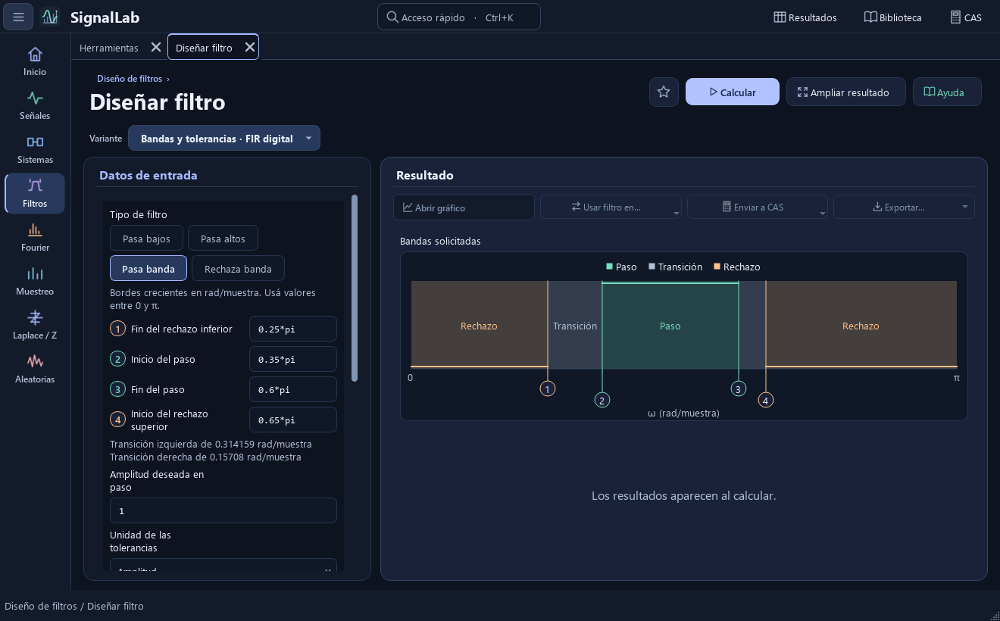

# SignalLab PC

  

SignalLab PC es un laboratorio de escritorio en español para **Sistemas y Señales I y II** y procesamiento digital de señales. Podés estudiar señales continuas y discretas, calcular transformadas, analizar sistemas y diseñar filtros. Las herramientas combinan cálculo simbólico, simulación numérica, informes y gráficos.

[Descargas](#descargas) · [Herramientas](#herramientas) · [Primeros pasos](#primeros-pasos) · [Documentación](#documentación)

## Descargas

| Canal | Cuándo elegirlo | Descarga |
| --- | --- | --- |
| **Estable / LTS** | Para clases, ejercicios y uso habitual. La versión estable vigente es **2.0.0**. | [Descargar estable](https://github.com/Tincho1286/SignalLab-PC/releases/latest) |
| **Preview** | Para probar el laboratorio de probabilidad, estadística y procesos de **2.3.0**, junto con comunicaciones y canales. | [Descargar Preview](https://github.com/Tincho1286/SignalLab-PC/releases/tag/v2.3.0) |

Cada versión ofrece un **instalador** y un **portable** para **Windows x64** y **Linux x86_64**. Ambos incluyen Python y las dependencias. Elegí el instalador para actualizar desde **Ayuda → Buscar actualizaciones**, o el portable para ejecutar la aplicación desde una carpeta. El canal estable es el predeterminado. Podés habilitar las preliminares desde el actualizador. [Instalación y requisitos](docs/installation.md) · [Cómo actualizar](docs/installed-updates.md)

## Herramientas

| Área | Qué podés hacer |
| --- | --- |
| **Señales** | Crear señales con fórmulas, tramos o muestras. Generar ventanas y calcular convolución, correlación, energía y potencia. |
| **Sistemas LTI** | Cargar una función de transferencia H(s) o H(z), o deducirla de un diagrama de bloques. Analizar respuestas, polos, ceros y retardo de grupo. |
| **Filtros** | Diseñar FIR e IIR, definir filtros ideales por bandas y convertir filtros analógicos a digitales. |
| **Transformadas y ecuaciones** | Calcular series y transformadas de Fourier, Laplace y Z, incluidas inversas. Resolver ecuaciones diferenciales y en diferencias. |
| **Muestreo y espectros** | Estudiar aliasing y reconstrucción, cambiar la tasa de muestreo, comparar DFT y DTFT y estimar espectros. |
| **Señales aleatorias** | Generar procesos aleatorios y analizar sus estadísticas y espectros. |
| **Cálculo simbólico (CAS)** | Simplificar expresiones y operar con ecuaciones y matrices. |

  
   Diseño FIR por bandas y tolerancias.

[Catálogo completo](docs/tools.md) · [Alcance de Sistemas y Señales I y II](docs/scope/sys-i-ii.md) · [Alcance de Señales Aleatorias](docs/scope/random-signals.md)

## Primeros pasos

1. Buscá una herramienta con **Ctrl+K** y cargá sus datos. **F1** abre la ayuda de la operación activa.
2. Presioná **Calcular**. Consultá el informe o elegí **Abrir gráfico** para medir valores y comparar curvas.
3. Desde **Resultados**, retomá una salida guardada o enviala a una herramienta compatible. Por ejemplo, podés llevar un FIR recién diseñado a **Respuesta temporal** para estudiar su efecto sobre una señal.

La guía de inicio muestra cómo generar una ventana Hann, ver sus muestras y enviarla a Fourier. [Primer cálculo](docs/getting-started.md)

## Documentación

- **Uso diario** · Entradas, teclas rápidas, gráficos y mediciones. [Biblioteca de guías](docs/README.md) · [Gráficos y cursores](docs/cursors.md)
- **Datos y cálculo** · Formatos de intercambio, sesiones y criterios para interpretar resultados. [Archivos y sesiones](docs/file-formats.md) · [Convenciones matemáticas](docs/conventions.md)
- **Versiones** · Cambios y correcciones de cada entrega. [Historial de versiones](docs/releases/README.md) · [Novedades de 2.3.0](docs/releases/v2.3.0.md)

## Desarrollo y contribuciones

Engineering Core ofrece operaciones DSP desde Python y la consola. La documentación de desarrollo incluye ejemplos de DFT, FIR y cambio de tasa, además del trabajo en comunicaciones digitales y modelos de canal. [Guía de desarrollo](docs/development/README.md) · [Ejemplos de Python y CLI](docs/engineering/phase_02b/ENGINEERING_CORE_EXAMPLES.md)

La hoja de ruta de Engineering organiza la ampliación de laboratorios y las mejoras de las herramientas actuales. Las fases autorizadas y calificadas llegan a Preview. La familia 2.0.x conserva su canal estable. [Roadmap](docs/engineering/ROADMAP.md) · [Plan de modernización](docs/engineering/TOOL_MODERNIZATION_PLAN.md) · [Política de entregas](docs/engineering/RELEASE_POLICY.md)

El laboratorio estadístico de la Preview ofrece generación, inferencia y experimentos reproducibles desde el escritorio, Python y la consola. El expediente incluye ejemplos de generación, ajuste y análisis de señales de canal. [Fase 05](docs/engineering/phase_05/README.md)

Si encontrás un problema, incluí la versión de SignalLab, los datos de entrada y el resultado esperado. [Informar un problema](https://github.com/Tincho1286/SignalLab-PC/issues/new/choose) · [Cómo contribuir](CONTRIBUTING.md)

SignalLab PC es software libre bajo **GPL-3.0-or-later**. [Licencia](LICENSE) · [Avisos de terceros](THIRD_PARTY_NOTICES.md) · [Privacidad](docs/privacy.md)
