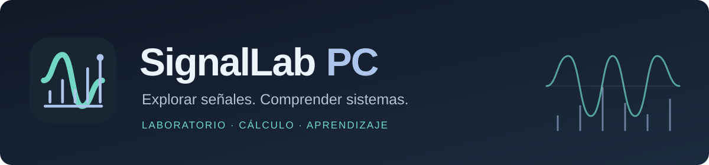
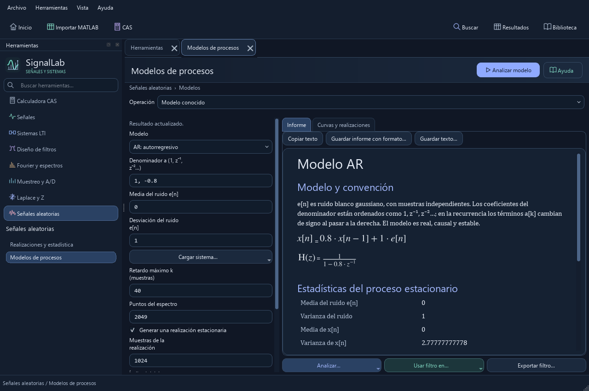
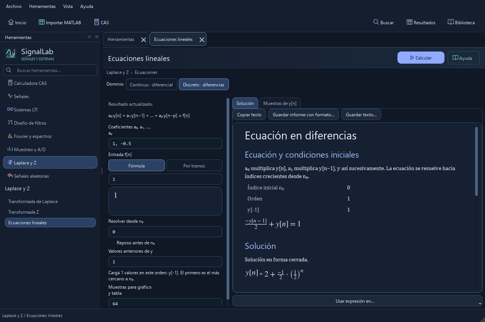
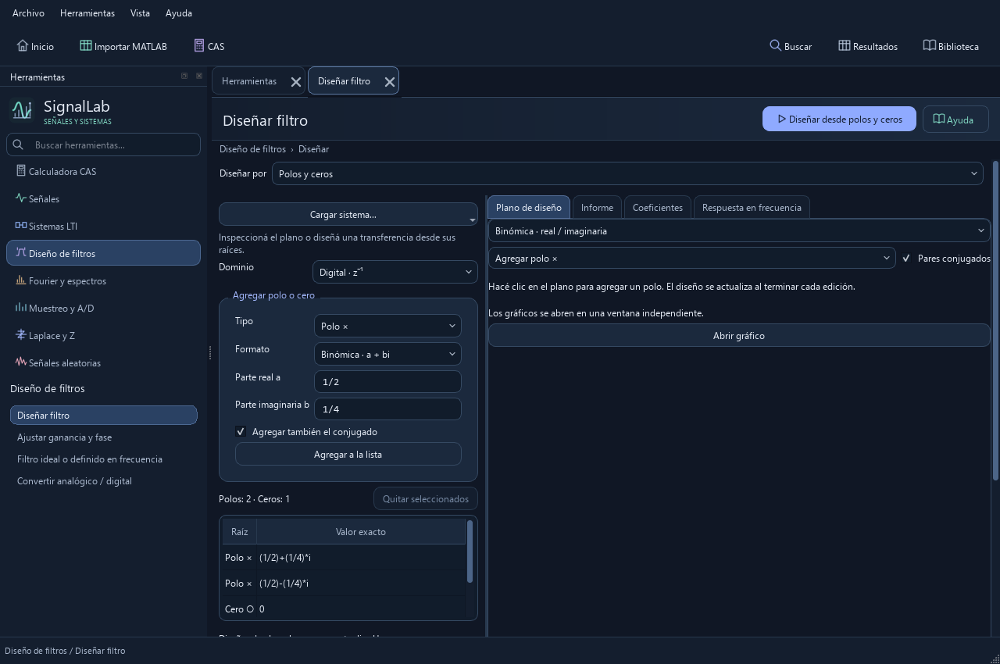

  

  
  
  
  

  <a href="https://github.com/Tincho1286/SignalLab-PC/releases/latest"><strong>Descargar</strong></a> ·
  <a href="docs/README.md">Documentación</a> ·
  <a href="docs/tools.md">Herramientas</a> ·
  <a href="CHANGELOG.md">Novedades</a> ·
  <a href="https://github.com/Tincho1286/SignalLab-PC/issues">Informar un problema</a>

# SignalLab PC

SignalLab PC es un laboratorio de escritorio para estudiar **señales, sistemas y procesamiento digital** mediante cálculos numéricos y simbólicos. Permite definir señales, analizar sistemas y diseñar filtros para explorar su comportamiento en el tiempo, la frecuencia y los planos de Laplace y Z.

Cada herramienta admite sus propios datos de entrada. Los resultados calculados se reúnen en una biblioteca desde la que podés consultarlos, exportarlos o utilizarlos en otra operación. Así, un mismo análisis puede continuar en distintas herramientas sin volver a cargar sus datos.

## Qué podés hacer

| Área | Herramientas |
| --- | --- |
| **Señales** | Definición por fórmulas, tramos y muestras; ventanas, transformaciones, suma, producto, convolución y correlación. |
| **Sistemas LTI** | Análisis de H(s) y H(z), respuesta temporal y en frecuencia, fase, retardo de grupo, polos y ceros, realizaciones y espacio de estados. |
| **Diseño de filtros** | FIR e IIR por especificaciones, enventanado de h[n], ubicación de polos y ceros, ajuste de fase y conversión entre filtros analógicos y digitales. |
| **Fourier y espectros** | DFT/FFT, DTFT, Fourier continua y sus inversas; series, densidad espectral, periodograma, Welch, Hilbert y STFT. |
| **Muestreo y precisión** | Muestreo, aliasing, reconstrucción, conversión de tasa, cuantización y estudio de precisión numérica. |
| **Laplace y Z** | Transformadas directas e inversas con condiciones de convergencia; ecuaciones diferenciales y en diferencias. |
| **Señales aleatorias** | Generación de realizaciones, estadísticas, correlación, modelos AR/MA/ARMA y estimación AR por Yule–Walker. |
| **Calculadora CAS** | Operaciones simbólicas con expresiones, ecuaciones y matrices; simplificación y manejo de supuestos. |

El [catálogo de herramientas](docs/tools.md) explica dónde encontrar cada operación. Las [convenciones matemáticas](docs/conventions.md) describen cómo se interpretan los índices, las frecuencias y las regiones de convergencia.

## Descargar y empezar

Los portables incluyen Python y las dependencias de la aplicación. Descargá la versión 1.6.11 para Windows o Linux. Las entregas anteriores están en Releases.

| Edición | Windows x64 | Linux x86_64 | Novedades |
| --- | --- | --- | --- |
| **Estable · 1.6.11 Hotfix** | [Descargar .exe](https://github.com/Tincho1286/SignalLab-PC/releases/download/v1.6.11/SignalLab-PC-1.6.11.exe) | [Descargar .tar.gz](https://github.com/Tincho1286/SignalLab-PC/releases/download/v1.6.11/SignalLab-PC-1.6.11-linux-x86_64.tar.gz) | [Notas de la estable](docs/releases/v1.6.11.md) |
| **Preliminar · 1.6.13** | [Descargar .exe](https://github.com/Tincho1286/SignalLab-PC/releases/download/v1.6.13-preview/SignalLab-PC-1.6.13.exe) | [Descargar .tar.gz](https://github.com/Tincho1286/SignalLab-PC/releases/download/v1.6.13-preview/SignalLab-PC-1.6.13-linux-x86_64.tar.gz) | [Notas de la preliminar](docs/releases/v1.6.13-preview.md) |

La 1.6.11 Hotfix muestra las fórmulas de las respuestas temporales y permite reutilizar filtros por tramos en Fourier algebraica. La actualización del CAS conserva las condiciones de la DTFT y permite enviar fórmulas y muestras desde Filtros ideales. Las [notas de la 1.6.11](docs/releases/v1.6.11.md) detallan los cambios.

En Windows, abrí el ejecutable descargado. En Linux, descomprimí el paquete y ejecutá `SignalLab-PC` dentro de su carpeta; consultá los [requisitos e instrucciones de Linux](docs/linux.md) para comprobar la compatibilidad de tu sistema.

Para comenzar un cálculo, buscá una herramienta, completá sus entradas y presioná **Calcular**. **F1** abre la ayuda de la herramienta activa. La [guía de primeros pasos](docs/getting-started.md) recorre este flujo con un ejemplo.

## Trabajar con los resultados

Los informes presentan las expresiones con notación matemática y explican las condiciones necesarias para interpretarlas. Según el método, distinguen una solución simbólica, una aproximación numérica o un cálculo que todavía no pudo resolverse.

Las figuras se abren en ventanas independientes y las señales discretas se representan mediante tallos. La [guía de gráficos y cursores](docs/cursors.md) explica las opciones de medición, incluida la lectura de valores y diferencias entre dos puntos.

La biblioteca **Resultados** conserva las salidas calculadas para continuar el trabajo. Podés enviar una expresión al CAS, reutilizar un sistema o exportar los datos en los [formatos compatibles](docs/file-formats.md). Si modificás una entrada, el resultado anterior se mantiene hasta que vuelvas a calcular.

## Vistas de la aplicación

El análisis de procesos reúne la definición del modelo, sus ecuaciones y sus estadísticas en un mismo documento.

| Ecuaciones en diferencias | Diseño por polos y ceros |
| --- | --- |
|  |  |

Estas capturas corresponden a la línea 1.1 y sirven como referencia visual de las herramientas.

## Objetivos del proyecto

El desarrollo busca facilitar tanto la resolución de problemas como la comprensión de los métodos utilizados. Los objetivos pendientes se concentran en mejorar la experiencia de uso de las herramientas existentes:

- Hacer más claras las unidades, el reloj de muestreo y las condiciones de los datos al cargarlos o reutilizarlos.
- Ampliar las ayudas con figuras y casos completos que expliquen cómo elegir e interpretar cada parámetro.
- Extender las opciones de medición a más tipos de gráficos.
- Mostrar con mayor claridad las etapas de los cálculos simbólicos y el alcance de sus resultados.
- Consolidar la cobertura de Sistemas y Señales I/II y Señales Aleatorias con métodos consistentes y explicaciones accesibles.

La [hoja de objetivos](docs/roadmap.md) desarrolla estas líneas de trabajo. Las funciones ya publicadas y sus cambios se consultan en el [historial de versiones](CHANGELOG.md).

## Documentación

| Para… | Consultá… |
| --- | --- |
| Empezar a trabajar | [Primeros pasos](docs/getting-started.md) |
| Encontrar una operación | [Catálogo de herramientas](docs/tools.md) |
| Elegir los colores de la aplicación | [Temas de apariencia](docs/appearance.md) |
| Leer y medir una figura | [Gráficos y cursores](docs/cursors.md) |
| Revisar el alcance de la materia | [Sistemas y Señales I/II](docs/scope/sys-i-ii.md) · [Señales Aleatorias](docs/scope/random-signals.md) |
| Consultar las demás guías | [Índice de documentación](docs/README.md) |

## Desarrollo y contribuciones

La aplicación está desarrollada en **Python 3.12**, con **PySide6, NumPy, SciPy, SymPy y Matplotlib**. El código se encuentra en `signallab_pc/`; la [guía de desarrollo](docs/development/README.md) explica su estructura y cómo preparar el entorno.

Para informar un problema o proponer una mejora, consultá la [guía de contribución](CONTRIBUTING.md). Una descripción de la herramienta, los datos de entrada y el comportamiento esperado permite reproducir el caso y discutir la solución.

## Licencia

SignalLab PC se distribuye bajo **GNU GPL versión 3 o posterior**. Podés usarlo, estudiar su código, modificarlo y redistribuirlo, incluso con fines comerciales. Las versiones modificadas que se distribuyan deben conservar la licencia GPL y facilitar su código fuente conforme a sus términos. El software se distribuye sin garantía.

[Licencia completa](LICENSE) · [Uso y redistribución](docs/license.md) · [Avisos del proyecto](NOTICE.md) · [Licencias de terceros](THIRD_PARTY_NOTICES.md)
