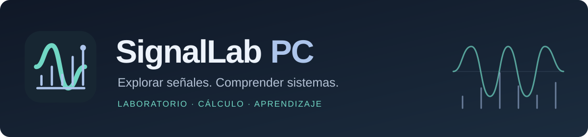

<p align="center">
  
</p>

<p align="center">
  <a href="https://github.com/Tincho1286/SignalLab-PC/releases/latest"><strong>Descargar estable</strong></a> ·
  <a href="#engineering-core-en-develop">Engineering Core</a> ·
  <a href="docs/getting-started.md">Primeros pasos</a> ·
  <a href="docs/tools.md">Herramientas</a> ·
  <a href="docs/README.md">Documentación</a> ·
  <a href="docs/releases/README.md">Historial</a>
</p>

SignalLab PC es un laboratorio de escritorio para **Sistemas y Señales I/II y procesamiento digital de señales**. Podés calcular una transformada, diseñar un filtro o estudiar un sistema LTI con cálculo simbólico, simulación numérica e informes. Podés reutilizar los resultados en otras herramientas compatibles. La aplicación está disponible en español para Windows y Linux.

## Engineering Core en develop

La rama `develop` incorpora el trabajo de **Fase 02B**. El escritorio y la API de Python comparten los servicios de DFT, IDFT, diseño y aplicación FIR, cambio racional de tasa y estimación de densidad espectral de potencia (PSD). Estos cálculos también se pueden ejecutar por consola sin cargar Qt.

El flujo **cambio de tasa → FIR → DFT y PSD** guarda los resultados intermedios en una sesión que podés abrir en el escritorio. La sesión conserva las unidades, el reloj de las señales y las relaciones entre entradas y resultados. La cancelación es cooperativa y el flujo publica sus resultados juntos cuando termina. Los proyectos y sesiones usan JSON. Para intercambiar señales individuales hay un formato binario experimental `.slbin` con verificación de integridad. [Contratos de la API](docs/engineering/phase_02b/ENGINEERING_CORE_API.md) · [Formatos y mediciones](docs/engineering/phase_02b/storage/STORAGE_BENCHMARK_REPORT.md)

### Probar el flujo desde el código fuente

Prepará el entorno de desarrollo y ejecutá estos comandos desde la raíz del repositorio. El primero genera una señal de ejemplo y el segundo guarda el flujo en `flujo.json`. [Preparar el entorno](docs/development/README.md)

```sh
python -B tools/example_engineering_core.py work/ejemplos-core
python -m signallab_pc dsp-pipeline --signal work/ejemplos-core/entrada.json --output work/ejemplos-core/flujo.json --up 2 --down 3 --fir .25 .5 .25 --psd-method periodogram --window boxcar
```

La validación de Fase 02B aprobó **850 pruebas integrales y 150 casos preventivos por plataforma** en Windows y Ubuntu. El informe de cierre reúne las pruebas, las mediciones y los límites de ejecución. [Ejemplos de Python y CLI](docs/engineering/phase_02b/ENGINEERING_CORE_EXAMPLES.md) · [Informe de Fase 02B](docs/engineering/phase_02b/closeout/PHASE_02B_CLOSEOUT.md)

## Descargar la versión estable

**2.0.0** corresponde a la distribución estable de la rama `main`. [Notas de la versión](docs/releases/v2.0.0.md) · [Código fuente y sumas SHA‑256](https://github.com/Tincho1286/SignalLab-PC/releases/tag/v2.0.0)

| Plataforma | Instalable | Portable |
| --- | --- | --- |
| Windows x64 | [Instalador .exe](https://github.com/Tincho1286/SignalLab-PC/releases/download/v2.0.0/SignalLab-PC-2.0.0-setup.exe) | [Ejecutable .exe](https://github.com/Tincho1286/SignalLab-PC/releases/download/v2.0.0/SignalLab-PC-2.0.0.exe) |
| Linux x86_64 | [Instalador .run](https://github.com/Tincho1286/SignalLab-PC/releases/download/v2.0.0/SignalLab-PC-2.0.0-linux-x86_64.run) | [Archivo .tar.gz](https://github.com/Tincho1286/SignalLab-PC/releases/download/v2.0.0/SignalLab-PC-2.0.0-linux-x86_64.tar.gz) |

Los cuatro paquetes incluyen Python y las dependencias. Si querés actualizar desde la aplicación, elegí el instalable y abrí **Ayuda → Buscar actualizaciones**. Para ejecutar SignalLab desde una carpeta, elegí el portable. [Requisitos e instrucciones](docs/installation.md) · [Canales de actualización](docs/installed-updates.md).

<p align="center">
  
  <br><sub>Diseño FIR por bandas y tolerancias.</sub>
</p>

## Herramientas

| Qué querés estudiar | Qué podés hacer |
| --- | --- |
| **Señales y operaciones** | Crear fórmulas, funciones por tramos, ventanas o registros. Calcular convolución, correlación, energía, potencia y RMS. |
| **Sistemas y filtros** | Obtener H(s) o H(z) de una fórmula, coeficientes o un diagrama de bloques. Ver respuestas, polos, ceros y retardo. Diseñar FIR e IIR, enventanar h[n] y definir filtros ideales por bandas. |
| **Transformadas y ecuaciones** | Calcular Fourier, Laplace y Z con las condiciones que correspondan. Obtener inversas y resolver ecuaciones diferenciales y en diferencias con condiciones iniciales. |
| **Muestreo y espectros** | Estudiar aliasing, reconstrucción, cambio de tasa y cuantización. Comparar DFT y DTFT, probar ventanas y analizar espectros con periodograma, Welch o STFT. |
| **CAS y señales aleatorias** | Operar con expresiones, supuestos y matrices. Generar registros aleatorios, comparar estadísticas y trabajar con modelos AR, MA y ARMA. |

Consultá el [catálogo detallado](docs/tools.md) o el alcance por materia para [Sistemas y Señales I/II](docs/scope/sys-i-ii.md) y [Señales Aleatorias](docs/scope/random-signals.md).

## Flujo de trabajo

1. Abrí una herramienta desde el catálogo o buscala con **Ctrl+K**. Cada herramienta tiene sus propias entradas. **F1** abre la ayuda del cálculo activo.
2. Presioná **Calcular** y leé el informe. Desde el mismo resultado podés abrir las figuras, consultar muestras con el cursor o comparar curvas.
3. Usá **Usar señal en…** o **Usar filtro en…** para continuar en otra herramienta. Desde **Resultados** podés exportar objetos e informes. **Archivo → Sesiones** guarda el trabajo para retomarlo después.

Por ejemplo, podés diseñar un FIR por tolerancias, revisar sus bandas y usar ese mismo filtro en una respuesta temporal. [Primeros pasos](docs/getting-started.md) · [Gráficos y mediciones](docs/cursors.md) · [Sesiones y formatos](docs/file-formats.md).

## Novedades de la 2.0.0

El nuevo escritorio agrupa las variantes en un selector que se puede abrir desde el informe o los datos. La ayuda sigue el método activo y los avisos de validación llevan al campo que hay que corregir. En diseños FIR e IIR, el esquema de bandas muestra sus bordes con acceso directo a los parámetros.

Las figuras permiten elegir una curva de referencia y seguir sus muestras con los cursores. En **Resultados** podés distinguir tipos de salida, abrir gráficos guardados y seguir los vínculos con los datos que originaron cada cálculo. [Notas completas](docs/releases/v2.0.0.md) · [Historial de cambios](CHANGELOG.md).

## Proyecto abierto

Podés revisar las [convenciones matemáticas](docs/conventions.md), consultar los [objetivos del proyecto](docs/roadmap.md) o preparar un entorno con la [guía de desarrollo](docs/development/README.md). Si encontrás un problema de cálculo o de uso, incluí los datos de entrada y el resultado esperado en [Issues](https://github.com/Tincho1286/SignalLab-PC/issues/new/choose). [Cómo contribuir](CONTRIBUTING.md).

SignalLab PC se distribuye bajo [GPL-3.0-or-later](LICENSE). [Guía de la licencia](docs/license.md) · [Avisos de terceros](THIRD_PARTY_NOTICES.md) · [Privacidad](docs/privacy.md).
