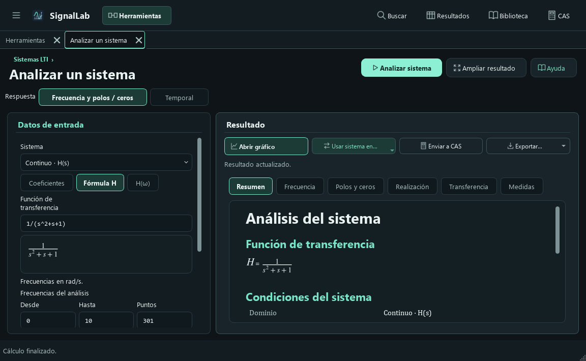
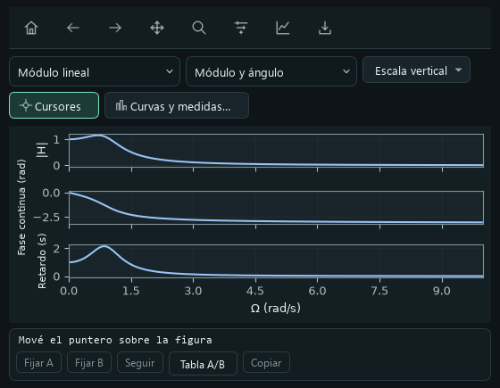

  

  
  
  
  

  <a href="https://github.com/Tincho1286/SignalLab-PC/releases/latest"><strong>Descargar</strong></a> ·
  <a href="docs/getting-started.md">Primeros pasos</a> ·
  <a href="docs/tools.md">Herramientas</a> ·
  <a href="docs/releases/README.md">Novedades</a> ·
  <a href="https://github.com/Tincho1286/SignalLab-PC/issues">Informar un problema</a>

# SignalLab PC

SignalLab PC es un laboratorio de escritorio para estudiar **señales, sistemas y procesamiento digital**. Combina cálculo simbólico, simulación numérica y gráficos para relacionar una definición matemática con su comportamiento en el tiempo, la frecuencia y los planos de Laplace y Z. Está orientado al aprendizaje de Sistemas y Señales I/II y al análisis de problemas de laboratorio; también incorpora herramientas de señales aleatorias.

Cada herramienta tiene sus propias entradas y puede utilizarse de manera independiente. Después de calcular, la biblioteca **Resultados** permite consultar la salida, exportarla o enviarla a otra operación compatible. Este recorrido evita volver a escribir una señal, un filtro o una expresión cuando el análisis continúa en otra herramienta.

## Descargar

La versión estable **1.9.2** está disponible para Windows x64 y Linux x86_64. Los cuatro paquetes incluyen Python y las dependencias de la aplicación; no hace falta instalar Python por separado.

| Formato | Cuándo elegirlo | Windows x64 | Linux x86_64 |
| --- | --- | --- | --- |
| **Instalable** | Para tener accesos en el sistema y actualizar desde la aplicación. | [Instalador .exe](https://github.com/Tincho1286/SignalLab-PC/releases/download/v1.9.2/SignalLab-PC-1.9.2-setup.exe) | [Instalador .run](https://github.com/Tincho1286/SignalLab-PC/releases/download/v1.9.2/SignalLab-PC-1.9.2-linux-x86_64.run) |
| **Portable** | Para ejecutar la aplicación desde una carpeta, sin registrar una instalación. | [Ejecutable .exe](https://github.com/Tincho1286/SignalLab-PC/releases/download/v1.9.2/SignalLab-PC-1.9.2.exe) | [Paquete .tar.gz](https://github.com/Tincho1286/SignalLab-PC/releases/download/v1.9.2/SignalLab-PC-1.9.2-linux-x86_64.tar.gz) |

En Windows, abrí el archivo elegido. En Linux, el instalador se inicia con `sh ./SignalLab-PC-1.9.2-linux-x86_64.run`; el portable se descomprime para ejecutar `SignalLab-PC` dentro de su carpeta. La [guía de instalación](docs/installation.md) explica ambos recorridos y enlaza los requisitos y las posibles alertas del sistema.

### Canal estable y preliminares

La **1.9.5 preliminar** conserva las muestras editadas al reabrir una sesión, actualiza el reloj al cambiar de señal y corrige casos de precisión numérica y de la transformada de Laplace. Para recibirla desde una instalación existente, elegí **Estables y preliminares (Pre-releases)** en el actualizador. [Descargas de la preliminar](https://github.com/Tincho1286/SignalLab-PC/releases/tag/v1.9.5) · [Notas de la 1.9.5](docs/releases/v1.9.5.md).

### Actualizar una instalación

La edición instalada ofrece **Ayuda → Buscar actualizaciones**. Podés consultar las novedades, descargar la versión nueva y elegir cuándo instalar y reiniciar, sin desinstalar antes. Los temas y la configuración se conservan; los resultados de una sesión deben guardarse o exportarse antes del reinicio.

Desde el mismo diálogo podés elegir sólo estables o incluir preliminares (Pre-releases); la preferencia se conserva. La comprobación al iniciar se puede desactivar y no descarga ni instala por sí sola. El actualizador verifica la firma del manifiesto y la integridad del instalador antes de ejecutarlo. La [guía de actualizaciones](docs/installed-updates.md) explica este proceso y la diferencia entre esa verificación y la firma que reconoce Windows.

## Herramientas disponibles

| Área | Qué permite estudiar |
| --- | --- |
| **Señales** | Definir fórmulas, tramos y muestras; generar ventanas; desplazar, invertir, sumar o multiplicar señales; calcular convolución, correlación, energía, potencia y RMS. |
| **Sistemas LTI** | Obtener H(s) y H(z) a partir de coeficientes, fórmulas o diagramas de bloques. Analizar respuestas, fase, retardo, polos y ceros, y estudiar modelos de espacio de estados. |
| **Filtros** | Diseñar FIR e IIR por bandas y tolerancias; enventanar una h[n] propia; ubicar polos y ceros; ajustar fase y convertir entre filtros analógicos y digitales. Los filtros ideales se pueden definir por tramos en frecuencia. |
| **Fourier y espectros** | Calcular DFT/FFT, DTFT, Fourier continua e inversas disponibles; estudiar series, densidades espectrales, periodograma, Welch, Hilbert y STFT. |
| **Muestreo y precisión** | Explorar muestreo, aliasing, reconstrucción, cambios de tasa, cuantización y efectos de la representación numérica en señales y filtros. |
| **Laplace, Z y ecuaciones** | Obtener transformadas e inversas con sus condiciones; resolver ecuaciones diferenciales y en diferencias lineales con coeficientes constantes y condiciones iniciales. |
| **Señales aleatorias** | Generar registros, estimar estadísticas y correlaciones, analizar modelos estacionarios AR/MA/ARMA y ajustar modelos AR mediante Yule–Walker. |
| **Calculadora CAS** | Operar con expresiones, ecuaciones, matrices y supuestos; simplificar resultados y continuar cálculos simbólicos recibidos desde otras herramientas. |

El [catálogo de herramientas](docs/tools.md) describe las entradas y salidas de cada área. Las matrices de [Sistemas y Señales I/II](docs/scope/sys-i-ii.md) y [Señales Aleatorias](docs/scope/random-signals.md) distinguen las capacidades disponibles de los temas pendientes y de las restricciones de cada método.

## Cómo se trabaja

Elegí una operación en **Herramientas** o buscala con **Ctrl+K**. Completá sus entradas y presioná **Calcular**; el resultado reúne el informe, las fórmulas y las opciones de tabla o gráfico que correspondan. **F1** abre la ayuda de la herramienta activa, con explicaciones de los parámetros y de la interpretación del cálculo.

Las figuras se abren en ventanas independientes y las secuencias discretas se representan mediante tallos. Los cursores permiten consultar muestras y comparar dos posiciones sin modificar los datos calculados. La [guía de gráficos](docs/cursors.md) explica qué se mide en cada tipo de vista y cómo ajustar el alcance del plano de polos y ceros.

Para continuar un análisis, usá **Usar señal en…**, **Usar filtro en…** o la acción de reutilización disponible junto al resultado. La aplicación conserva el tipo de objeto y las condiciones registradas, y ofrece destinos compatibles. Por ejemplo, una ventana generada en Señales puede pasar a Fourier; un filtro diseñado puede analizarse en frecuencia o utilizarse en una respuesta temporal.

La biblioteca **Resultados** conserva las salidas durante el trabajo y permite exportar objetos o informes. En la 1.9.4 preliminar, **Resultado con dependencias** exporta también las entradas registradas de un cálculo. **Archivo → Sesiones** guarda la biblioteca, las entradas compatibles y las herramientas abiertas para retomar el trabajo. [Guía de formatos y sesiones](docs/file-formats.md).

## Interpretar los cálculos

Los informes distinguen expresiones simbólicas, aproximaciones numéricas y operaciones pendientes. También conservan las condiciones que cambian el significado del resultado, como el soporte de una secuencia o su región de convergencia. Una fórmula y una tabla finita no representan necesariamente el mismo objeto; las [convenciones matemáticas](docs/conventions.md) explican esas diferencias.

El alcance depende del método elegido y de sus hipótesis. Una evaluación sobre una rejilla no certifica todos los puntos de una función, y el motor simbólico puede dejar una expresión sin resolver. La [guía de fiabilidad](docs/mathematical-reliability.md) describe los criterios y controles utilizados, sin presentar esas comprobaciones como una garantía de resolución universal.

## Novedades e historial

La 1.9.5 preliminar registra las muestras modificadas de un borrador y conserva su fórmula como referencia cuando deja de representar la tabla. También corrige los relojes de muestreo y el cálculo de Laplace de polinomios multiplicados por exponenciales. [Notas de la 1.9.5](docs/releases/v1.9.5.md).

La 1.9.4 preliminar conserva las condiciones de las expresiones, las matrices y las señales por canal al abrir una sesión. La STFT distingue entre segundos relativos e instantes absolutos según los datos disponibles. El remuestreo sinc conserva resultados representables con amplitudes muy grandes. [Notas de la 1.9.4](docs/releases/v1.9.4.md).

La 1.9.3 preliminar incorpora el guardado de sesiones y ofrece recuperar el último punto local tras un cierre inesperado. También corrige medidas de energía y RMS para amplitudes muy pequeñas. [Notas de la 1.9.3](docs/releases/v1.9.3.md).

La 1.9.2 muestra el aviso al iniciar cuando detecta una actualización compatible. También completa el período de las señales cuando puede determinarlo a partir de la fórmula y conserva el período de los coeficientes de una serie importada. [Notas de la 1.9.2](docs/releases/v1.9.2.md).

La 1.9.1 explica qué va en cada argumento de las fórmulas. La biblioteca distingue el uso discreto y continuo de Repeat y RepeatSamples y ofrece ejemplos que se pueden copiar. [Notas de la 1.9.1](docs/releases/v1.9.1.md).

La 1.9.0 Hotfix corrige las operaciones con escalones, pulsos e impulsos y amplía las transformadas de trenes de Dirac recortados o amortiguados. El editor permite cambiar cada signo del sumador. Reúne las mejoras de señales periódicas, energía y potencia, DTFT y diagramas de sistemas LTI de las versiones 1.8.19 a 1.8.27. [Notas de la 1.9.0](docs/releases/v1.9.0.md).

La 1.8.27 agiliza la DTFT de secuencias con colas recíprocas y conserva sus condiciones al abrir el análisis. También calcula la potencia exacta de productos de señales continuas con dos períodos inconmensurables. [Notas de la 1.8.27](docs/releases/v1.8.27.md).

La 1.8.26 corrige la potencia de cosenos discretos con fase y calcula la energía de trenes amortiguados. Las fórmulas completas se pueden reutilizar después del ajuste de amplitud o la descomposición par e impar. [Notas de la 1.8.26](docs/releases/v1.8.26.md).

La 1.8.25 calcula la potencia exacta de sumas de trenes continuos aunque sus períodos no coincidan. Fourier y Laplace conservan el aporte de cada ciclo y distinguen las colas de los recortes finitos. [Notas de la 1.8.25](docs/releases/v1.8.25.md).

La 1.8.24 renueva el editor de diagramas LTI. Podés arrastrar cables entre los bloques, usar puertos de suma o resta y leer las fórmulas centradas dentro del diagrama. [Notas de la 1.8.24](docs/releases/v1.8.24.md).

La 1.8.23 calcula Fourier y DTFT generalizadas de trenes unilaterales. Las líneas conservan sus áreas y la curva se interrumpe en los polos del valor principal. [Notas de la 1.8.23](docs/releases/v1.8.23.md).

La 1.8.22 conserva las fórmulas periódicas escritas a mano y las envía a Fourier o DTFT. El análisis de un tren recortado separa las líneas del tren y la contribución del tramo eliminado. [Notas de la 1.8.22](docs/releases/v1.8.22.md).

La 1.8.21 mejora el contraste y el tamaño de las casillas en toda la aplicación. También amplía energía, Z y Laplace para trenes recortados y reconoce espectros periódicos pegados en Fourier inversa. [Notas de la 1.8.21](docs/releases/v1.8.21.md).

La 1.8.20 amplía el cálculo exacto de energía y potencia con envolventes oscilatorias. Fourier recupera formas periódicas a partir de su espectro de líneas y Laplace integra un período completo. [Notas de la 1.8.20](docs/releases/v1.8.20.md).

La 1.8.19 preliminar crea señales periódicas a partir de fórmulas o muestras, permite desplazarlas verticalmente y muestra sus espectros de líneas. También amplía el cálculo de energía y potencia global, y actualiza los símbolos del editor LTI. [Notas de la 1.8.19](docs/releases/v1.8.19.md).

La 1.8.18 estable permite obtener H(s) o H(z) desde un diagrama en Sistemas LTI. Podés conectar bloques de transferencia en cascada, paralelo o realimentación y cargar cada bloque desde una fórmula o un sistema guardado. Incluye el nuevo catálogo por áreas, los ajustes de controles y gráficos y la revisión de informes y guías de las versiones 1.8.15 a 1.8.17. [Notas de la 1.8.18](docs/releases/v1.8.18.md).

La 1.8.17 preliminar amplía la revisión de los informes de Fourier, filtros y sistemas. Las salidas muestran las fórmulas, los valores y las condiciones que se aplican al cálculo. La Biblioteca y el manual explican los métodos. [Notas de la 1.8.17](docs/releases/v1.8.17.md).

La 1.8.16 preliminar corrige la superposición de controles al desplazarse y mantiene verticales los rótulos de los gráficos. Los informes revisados priorizan los valores calculados y sus condiciones; la Biblioteca concentra el detalle de los métodos. [Notas de la 1.8.16](docs/releases/v1.8.16.md).

La 1.8.15 preliminar agrupa la navegación en un catálogo con búsqueda por nombre o concepto. Los formularios y los informes usan el ancho de la ventana y las acciones de salida se encuentran siempre junto al resultado. [Notas de la 1.8.15](docs/releases/v1.8.15.md).

La [1.8.14 estable](docs/releases/v1.8.14.md) concentra cinco mejoras en la carga, edición y combinación de señales. La vista previa valida los datos antes de usarlos; el historial mantiene independientes las salidas aplicadas y la extracción conserva los índices y el reloj. Suma y producto permiten intercambiar definiciones y consultar sus valores alineados junto al informe. La [guía de herramientas básicas](docs/basic-usability.md) desarrolla el alcance de estas operaciones.

La [1.8.13 preliminar](docs/releases/v1.8.13.md) compara tres modelos de reconstrucción sobre las mismas muestras y permite medir sus diferencias con una referencia. La ventana ampliable revela los bordes y las colas de los núcleos. La tabla de nudos y el inspector relacionan cada curva con sus muestras, pesos y reloj, sin interpretar una coincidencia nodal como prueba de ausencia de aliasing. La [guía de reconstrucción](docs/reconstruction-studies.md) desarrolla estas operaciones y la exportación completa de comparaciones.

La [1.8.12 preliminar](docs/releases/v1.8.12.md) relaciona las medidas del registro con la posición de su energía. Permite elegir sus muestras, consultar la acumulada, medir centro y dispersión y conservar media y alterna como señales separadas. La tabla de cruces distingue eventos discretos, contactos continuos y saltos de una retención. El informe muestra el intervalo efectivo y la ayuda explica sus unidades. La [guía de medidas de registros](docs/record-measurements.md) desarrolla estas operaciones.

La [1.8.11 preliminar](docs/releases/v1.8.11.md) permite examinar las matrices del diagnóstico, cambiar coordenadas con la condición inicial correspondiente y buscar equilibrios únicos o familias. La simulación separa estado cero y entrada cero y permite consultar entradas, estados y salidas. Paso a paso explica la misma componente elegida en la figura, conservando su posición y variable. La [guía de estudios de estados](docs/state-studies.md) desarrolla esas relaciones y distingue las operaciones algebraicas del modelo guardado de sus evaluaciones numéricas.

La [1.8.10 preliminar](docs/releases/v1.8.10.md) incorpora Medidas de frecuencia dentro de Analizar sistema. Permite consultar frecuencias desde la definición, buscar niveles y comprobar bandas con sus límites, extremos y márgenes. El retardo se resume por intervalo y la figura relaciona las posiciones de la tabla con la respuesta. La [guía de medidas de frecuencia](docs/frequency-measurements.md) precisa el alcance numérico y cómo conservar sus resultados.

La [1.8.9 preliminar](docs/releases/v1.8.9.md) reúne cinco mejoras en Respuesta temporal. Permite prolongar entradas propias con ceros, preparar un intervalo desde los polos y comparar entrada, salida y memoria. Las medidas del escalón usan la ganancia DC del modelo y distinguen lo observado en el registro. Paso a paso relaciona cada muestra con los coeficientes y el historial guardados. La [guía de respuesta temporal](docs/temporal-responses.md) desarrolla estas operaciones y sus límites.

La [1.8.8 estable](docs/releases/v1.8.8.md) corrige el acceso al inspector y desarrolla las fórmulas de módulo, fase y componentes. Máximos y mínimos completa la tabla al abrirse, mide en la vista o entre A/B y marca las posiciones encontradas. Consolida las ampliaciones de gráficos, informes, espectros, STFT, biblioteca y estimación AR de las preliminares anteriores. La [guía de gráficos](docs/cursors.md) explica los cuadrantes de fase, el desenrollado y el alcance de los extremos de puntos.

La [1.8.7 preliminar](docs/releases/v1.8.7.md) reúne seis mejoras para leer figuras y navegar informes. La [guía de gráficos](docs/cursors.md) explica cómo consultar una definición, buscar extremos de los puntos calculados y colocar cursores sin interpolar. Los controles científicos se acomodan según el ancho de la ventana y las vistas LTI conservan su acceso a la respuesta en frecuencia.

La [1.8.6 preliminar](docs/releases/v1.8.6.md) amplía la estimación AR con comparación de órdenes, validación, pronóstico y diagnóstico residual. La [guía de estimación AR](docs/ar-estimation.md) desarrolla sus hipótesis. Las mejoras de medición de la [1.8.5](docs/releases/v1.8.5.md) y las de STFT y biblioteca de la [1.8.4](docs/releases/v1.8.4.md) se explican en las guías de [medidas espectrales](docs/spectral-measurements.md) y [ventanas temporales](docs/time-frequency.md). Estas preliminares se conservan como historial; sus mejoras están incluidas en la 1.8.8 estable.

La [1.8.3](docs/releases/v1.8.3.md) facilita abrir y elegir figuras, cambiar la tasa indicando la frecuencia de salida y analizar el FIR antialias utilizado. El CAS incorpora operaciones rápidas sobre la salida seleccionada, sin borrar el borrador, y el actualizador permite incluir preliminares con manifiesto firmado compatible. La [guía de actualizaciones](docs/installed-updates.md) explica cómo elegir el canal.

La [1.8.2](docs/releases/v1.8.2.md) amplía las mediciones en espectrogramas y mapas, permite ver y exportar B−A y recupera detalle en el espectro de ventanas al hacer zoom. La [guía de gráficos](docs/cursors.md) relaciona esas vistas con sus unidades, datos originales y condiciones de comparación. Está disponible en el canal estable de actualizaciones.

La [1.8.1 estable](docs/releases/v1.8.1.md) amplía las herramientas de análisis y reúne todas las mejoras posteriores a la 1.8.0. La [guía de análisis interactivo](docs/interactive-analysis.md) explica cómo comparar filtros, seleccionar condiciones y consultar los nuevos inspectores.

La [versión 1.8.0](docs/releases/v1.8.0.md) incorpora los instaladores y el canal de actualizaciones, manteniendo los portables y las mejoras matemáticas de la [1.7.0](docs/releases/v1.7.0.md). El [historial de cambios](CHANGELOG.md) ofrece un recorrido resumido; las [notas de cada versión](docs/releases/README.md) explican las incorporaciones, correcciones y límites de cada entrega.

## Informes y gráficos

| Informe de análisis LTI | Respuesta en frecuencia |
| --- | --- |
|  |  |

## Documentación y desarrollo

El índice de documentación reúne las guías de uso, los criterios matemáticos y la cobertura académica. **Primeros pasos** recorre un cálculo completo. **Señales periódicas y trenes** reúne la sintaxis de las fórmulas y muestra cómo llevarlas a energía, Fourier, Laplace y Z. [Documentación](docs/README.md) · [Primeros pasos](docs/getting-started.md) · [Señales periódicas y trenes](docs/periodic-signals.md).

La aplicación está desarrollada en Python 3.12 con PySide6, NumPy, SciPy, SymPy y Matplotlib. La [guía de desarrollo](docs/development/README.md) describe la estructura, las dependencias y la construcción. Para informar un problema o proponer una contribución, consultá [CONTRIBUTING.md](CONTRIBUTING.md).

## Licencia

SignalLab PC se distribuye bajo **GNU GPL versión 3 o posterior**. Podés usarlo, estudiar su código, modificarlo y redistribuirlo, incluso con fines comerciales, conforme a sus términos. Las versiones modificadas que se distribuyan deben conservar la GPL y facilitar su código fuente según la licencia. El software se distribuye sin garantía y las dependencias conservan sus propios avisos.

[Licencia](LICENSE) · [Uso y redistribución](docs/license.md) · [Avisos de terceros](THIRD_PARTY_NOTICES.md) · [Privacidad](docs/privacy.md)
