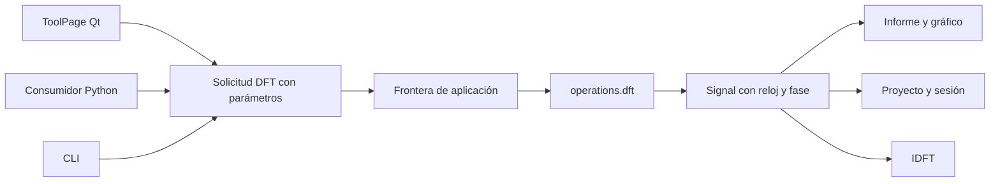

# ADR 001 · DFT como piloto de la frontera de aplicación

**Estado** autorizado como piloto de Fase 02 e implementado en `develop`. La decisión se limita a DFT directa e IDFT como consumidora. [Contrato y ejemplos](DFT_PILOT_API.md)

## Contexto

`ToolPage` recupera una `Signal` y una configuración de los controles, programa el cálculo y publica su salida. El motor `operations.dft` ya recibe argumentos explícitos y devuelve otra `Signal`. Puede ejecutarse sin iniciar Qt. La referencia de fase, el orden y las unidades sobreviven a través de metadatos validados por la inversa. La presentación y la carga de la sesión tienen acceso a la misma convención.

La DFT permite ensayar una frontera completa con parámetros discretos, cálculo cancelable, relojes opcionales y compatibilidad histórica. Un flujo simbólico guardaría condiciones de validez y un estado no evaluado, y uno de filtros incorporaría la ROC y causalidad. Esas diferencias quedarían para cuando exista evidencia de que el primer contrato funciona.

## Decisión

La frontera recibe `DFTRequest` y `DFTExecution`, usa el motor `operations.dft` y devuelve `DFTResult` con un espectro `Signal` y `DFTProvenance`. Qt, el consumidor Python y la CLI llaman a la misma función. `store_dft` entrega la salida y su fuente a `Project` en una sola operación. La CLI escribe con `session.save` y comprueba la cancelación antes del reemplazo atómico.

| Modelo | Evaluación antes de introducir otros tipos |
| --- | --- |
| `Signal` | Conserva datos uniformes, eje y reloj. Usarla en el piloto. Verificar que la representación del espectro no pueda perder el tamaño o la semántica de bins al pasar por una frontera. |
| `Transfer` | Mantiene representaciones racionales s/z, SOS y período. La validez de una respuesta exige conservar avances y ROC. El piloto DFT puede delimitar primero qué pertenece a un resultado y qué a un modelo. |
| `StateModel` | Mantiene matrices, canales y reloj. Incluirlo en otra revisión sólo si la frontera también necesita soportar modelos MIMO. |
| Resultado simbólico | Lleva expresión, notas y condiciones, con JSON entre procesos. Revisar su versión de protocolo por separado antes de generalizar. |
| `Project` y `session` | Ya resuelven identidad y persistencia. El piloto debe registrar el origen de la señal y los parámetros efectivos en la procedencia que se pueda recuperar. |

## Aceptación

El resultado y las condiciones deben coincidir desde Qt y Python para las pruebas analíticas y archivos históricos. Una cancelación no agrega registros. Una importación directa del motor no requiere Qt. El informe y gráfico conservan unidades y referencia. Cualquier parámetro nuevo tiene un valor histórico explícito para la carga de sesiones anteriores.

La frontera aplica presupuesto y plazo cooperativos. La FFT nativa entrega el control al terminar el bloque. La persistencia se comprueba antes de publicar el proyecto o reemplazar el archivo de sesión. Una generalización a otros motores requiere evidencia de sus propios contratos de datos y ejecución.
