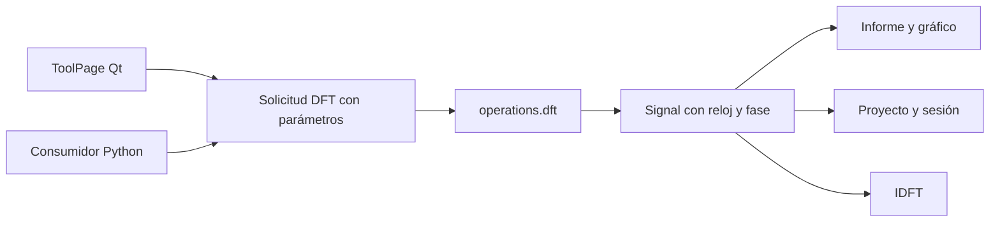

# ADR 001 · DFT como piloto de la frontera de aplicación

**Estado** propuesto para revisión al cierre de estabilización. La Fase 01 conserva el diseño actual.

## Contexto

`ToolPage` recupera una `Signal` y una configuración de los controles, programa el cálculo y publica su salida. El motor `operations.dft` ya recibe argumentos explícitos y devuelve otra `Signal`. Puede ejecutarse sin iniciar Qt. La referencia de fase, el orden y las unidades sobreviven a través de metadatos validados por la inversa. La presentación y la carga de la sesión tienen acceso a la misma convención.

La DFT permite ensayar una frontera completa con parámetros discretos, cálculo cancelable, relojes opcionales y compatibilidad histórica. Un flujo simbólico guardaría condiciones de validez y un estado no evaluado, y uno de filtros incorporaría la ROC y causalidad. Esas diferencias quedarían para cuando exista evidencia de que el primer contrato funciona.

## Decisión propuesta

Usar como primer flujo la DFT discreta directa con IDFT como consumidor de su salida. Adaptar las configuraciones actuales de UI a parámetros de operación explícitos. Reutilizar `Signal`, el motor y el registro de `Project`. Mantener los valores de referencia de fase y opciones que entienden los archivos existentes. La primera implementación separaría la preparación y ejecución de los controles, y pasaría el resultado a la presentación y a la persistencia.

| Modelo | Evaluación antes de introducir otros tipos |
| --- | --- |
| `Signal` | Conserva datos uniformes, eje y reloj. Usarla en el piloto. Verificar que la representación del espectro no pueda perder el tamaño o la semántica de bins al pasar por una frontera. |
| `Transfer` | Mantiene representaciones racionales s/z, SOS y período. La validez de una respuesta exige conservar avances y ROC. El piloto DFT puede delimitar primero qué pertenece a un resultado y qué a un modelo. |
| `StateModel` | Mantiene matrices, canales y reloj. Incluirlo en otra revisión sólo si la frontera también necesita soportar modelos MIMO. |
| Resultado simbólico | Lleva expresión, notas y condiciones, con JSON entre procesos. Revisar su versión de protocolo por separado antes de generalizar. |
| `Project` y `session` | Ya resuelven identidad y persistencia. El piloto debe registrar el origen de la señal y los parámetros efectivos en la procedencia que se pueda recuperar. |

## Aceptación

El resultado y las condiciones deben coincidir desde Qt y Python para las pruebas analíticas y archivos históricos. Una cancelación no agrega registros. Una importación directa del motor no requiere Qt. El informe y gráfico conservan unidades y referencia. Cualquier parámetro nuevo tiene un valor histórico explícito para la carga de sesiones anteriores.

Se limita el primer cambio a este flujo. Una reorganización de carpetas o una clase universal de resultado afectarían más rutas y requerirían evidencia adicional.
