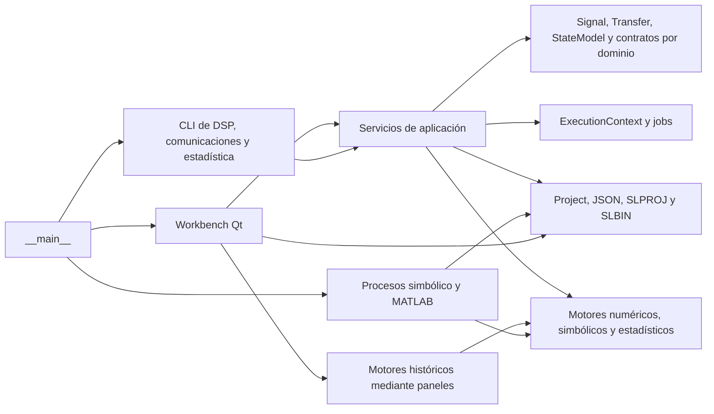
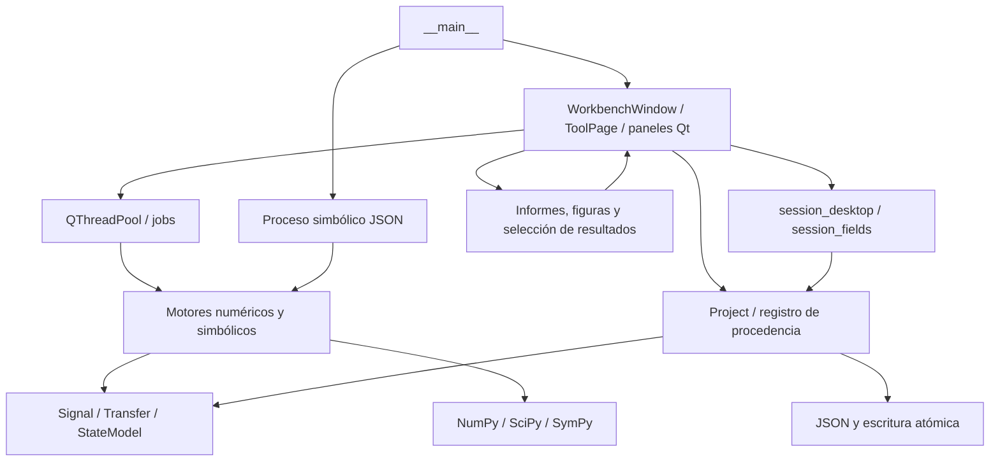

# Arquitectura actual de SignalLab PC

## RF y microondas en 2.4.0 Preview

El candidato `1eb462e24034a9c7f41183b4da4654334460d07c` agrega `RFNetwork` como instantánea multipuerto, con frecuencia en Hz y referencias reales de onda de potencia. `rf_application` media entre Workbench, Python y CLI, y registra solicitudes y resultados en `Project`. Los formatos JSON y SLPROJ conservan matrices, referencias y procedencia. `Transfer` conserva la semántica escalar de filtros analógicos y `Signal` las convenciones espectrales. La incertidumbre RF reutiliza las campañas del motor de Monte Carlo. [Arquitectura y dependencias](phase_06/ARCHITECTURE.md) · [Decisión RF](phase_06/ADR-006-RF-NETWORK.md)

## Línea base posterior a Fase 05

Se inspeccionó el árbol limpio `10fe3f218de2cdf183a4cc282ebd54aed403a981`, que integra el código de 2.3.1 Preview. Mediante `python -B tools/audit_dependencies.py --report work/strategy-post-05/import-graph.json` se midieron 438 archivos de aplicación y 66 953 líneas físicas. El AST registra 2 573 pares de importación interna, 1 419 al nivel superior y 185 módulos con importación directa de Qt o su backend. El grafo de declaraciones de nivel superior es acíclico. Al incluir las importaciones anidadas aparece un conjunto de cinco componentes cíclicos, con 274 módulos en el mayor. La métrica distingue estructura observada de ejecución efectiva. [Comprobante](evidence/post-phase-05-baseline.json) · [Reproductor](../../tools/audit_dependencies.py)

| Frontera observada | Responsabilidad y brecha |
| --- | --- |
| Entrada y Workbench | `__main__` despacha siete familias CLI, workers y GUI. `tool_catalog`, `workflow_catalog`, `navigation` y `workspaces` resuelven herramientas y alias. `toolbox`, los paneles y el controlador de sesiones todavía reúnen operaciones históricas con rutas específicas. |
| Cálculo sin Qt | `dft_application`, `dsp_application`, `dsp_pipeline` y servicios de comunicaciones y estadística resuelven contratos desde Python. La auditoría probó 23 módulos representativos con Qt bloqueado. La paridad se acredita por operación. |
| Ejecución | `ExecutionContext`, `jobs` y reservas compartidas aportan admisión y cancelación cooperativa. `symbolic_process` y `matlab_process` usan procesos dedicados. La garantía de cuota del lector MAT corresponde al perfil probado. |
| Almacenamiento | `project`, `session`, `project_archive` y `scientific_storage` implementan JSON, SLPROJ y SLBIN. `operation_provenance` verifica huellas. Los servicios registran transacciones y las campañas persistidas usan bloqueo y huellas por bloque. La hoja CAS activa tiene esquema propio en `session`. |
| Figuras y navegación | El Workbench prepara el documento incorporado y conserva borradores. Los gráficos cerrados difieren el dibujo. Las vistas de 2.3.1 actualizan la disponibilidad al mostrar una nueva figura de resultado. |

La frontera estadística reutiliza `Signal`, `Transfer`, `StateModel`, recursos y almacenamiento. Los métodos de GUI o CLI con una semántica propia se conectan mediante sus adaptadores. La evidencia del candidato cubre los recorridos definidos, incluidas cancelación y reapertura. [Motores y componentes críticos](SCIENTIFIC_ENGINE_INVENTORY.md) · [Arquitectura de Fase 05](phase_05/ARCHITECTURE.md) · [Evolución prevista](ARCHITECTURE_TO_BE.md)

## Línea base histórica de Fase 00

**Fase 00 · 24 de noviembre de 2026.** Línea base `16ffcbaee8356e41de6ed1e5e3410b607afe480f`. El rediseño local se inventarió aparte. Los límites que siguen describen las dependencias reales del código.

## Inventario y punto de entrada

| Alcance | Commit de referencia | Árbol local |
| --- | ---: | ---: |
| Python de aplicación, incluido `main.py` | 367 archivos, 46.580 líneas físicas | 375 archivos, 48.800 líneas físicas |
| Archivos `tests/test_*.py` | 58, 8.965 líneas | 58, 9.111 líneas |
| Dependencias internas, pares de módulos | 1.925 | 1.990 |
| Dependencias al nivel superior del módulo | 864 | 921 |
| Módulos que importan directamente Qt o su backend de Matplotlib | 173 | 178 |

Los conteos excluyen dependencias instaladas, documentación, historial y archivos generados. El catálogo local declara **30 herramientas y 84 rutas**. Una ruta puede representar una variante dentro de una herramienta. `main.py` y el entry point `signallab-pc` llevan a `signallab_pc.__main__`. Ese despachador atiende la interfaz, los procesos simbólicos y la autoverificación empaquetada.

| Área | Capacidades y módulos existentes |
| --- | --- |
| Señales | Fórmulas, tramos, muestras, CSV, JSON y MATLAB, ventanas, edición, medidas, aritmética, convolución y correlación. `engine`, `model`, `operations`, `continuous`, `matlab_import`. |
| Sistemas y filtros | Transferencias, respuesta temporal y frecuencial, diagramas, estados MIMO, diseño FIR/IIR e ideal, raíces, ganancia, fase y conversiones. `filters`, `realization_graph`, `temporal_analysis`, `state_space`, `course_tools`, `frequency_filter`. |
| Fourier y muestreo | DFT/FFT, DTFT, CTFT, series, espectros y densidades, Hilbert, STFT, aliasing, reconstrucción y cambio racional de tasa. `fourier`, `fourier_ordinary_pairs`, `dsp_extensions`, `sampling`. |
| Laplace, Z y CAS | EDO, recurrencias, transformadas directas e inversas, ROC, condiciones y cálculo simbólico. `symbolic`, `laplace_algebra`, `z_algebra`, `z_inverse`, `cas_engine`. |
| Señales aleatorias y precisión | Realizaciones reproducibles, estimación AR, procesos ARMA, estimadores de correlación, cuantización y ejecución de filtros. `random_signals`, `random_models`, `ar_estimation`, `precision`, `filter_arithmetic`. |
| Escritorio y distribución | Biblioteca de resultados, sesiones, informes, gráficos, cálculo cancelable, importación y actualización. `workbench`, `toolbox`, `plot_view`, `results_browser`, `project`, `session_desktop`, `update_ui`. |

## Dependencias observadas

El diagrama agrupa módulos. La última flecha refleja dependencias de presentación que vuelven a la interfaz, por ejemplo `workflow_inputs → toolbox` mediante una importación local. El registro completo se generó con el AST de los dos árboles. Se contó un par por módulo origen y destino, sin inferir importaciones dinámicas o la ejecución efectiva de una rama.

- **Comprobado.** En ninguno de los dos árboles se observó un componente fuertemente conexo de dos o más módulos con sólo las importaciones al nivel superior. Al incluir las importaciones locales aparecen cinco componentes. El mayor abarca 224 módulos en el commit y 229 en el árbol local. El resultado identifica acoplamiento estructural, aunque las cargas diferidas evitan que todas esas referencias se activen al iniciar.
- **Comprobado.** Los cuatro componentes pequeños son `custom_appearance ↔ theme_presets`, `library_catalog ↔ library_titles`, `probe_data ↔ signal_plot` y `update_channels ↔ update_download`. Revisar esos límites es más manejable que dividir primero el componente mayor.
- **Comprobado.** `toolbox` es el mayor concentrador. En el árbol local referencia 98 módulos y tiene 37 importadores. Los más reutilizados son `resources` (99), `jobs` (69), `result_summary` (67), `model` (55) y `numeric_input` (55).
- **Inferencia.** La separación más útil es extraer contratos de datos y de ejecución de los flujos que hoy atraviesan `ToolPage`, `PanelContext` y el registro de resultados. Cambiar archivos de carpeta antes de definir esos contratos trasladaría las dependencias existentes.

## Modelos y persistencia

| Representación | Contrato actual | Condición que debe preservar una migración |
| --- | --- | --- |
| `model.Signal` | Vector finito en `complex128`, eje uniforme. Índice discreto `int64` con paso 1. Origen y paso flotantes en dominios continuo y frecuencial. Metadatos de reloj y definición. | Mantener índices grandes exactos, invalidación de fórmulas al editar, unidades y procedencia. Una captura I/Q con huecos o más de un canal necesita un contrato adicional. |
| `filters.Transfer` | Coeficientes y dominio s/z, representación SOS cuando corresponde, avances y período opcional. La ROC se registra aparte de la expresión racional. | Mantener distinción entre estabilidad BIBO, interna y ROC. Conservar retardos y avances al intercambiar fórmulas y coeficientes. |
| `state_space.StateModel` | Matrices complejas A/B/C/D con dimensiones MIMO validadas. `dt=None` representa continuo. | Mantener orientación de canales, modos ocultos, rango numérico y semántica de retención. |
| `symbolic` / `symbolic_process` | Solicitudes y resultados JSON con expresión, condiciones, notas y salida numérica opcional. `jobs` ofrece cancelación cooperativa. | Versionar el contrato antes de convertirlo en API pública. Mantener resultados no evaluados, sólidos y distribucionales como estados diferenciados. |
| `project` / `session` | Proyectos compatibles con esquemas 1 y 2. Sesiones compatibles con 1, 2 y 3. Identidad, dependencias y acciones de restauración separadas. | Conservar importación de ambos formatos, escritura atómica, rechazo antes de reemplazar la sesión y exportación del cierre transitivo de un resultado. |

`SessionController` y `session_fields` son adaptadores Qt. El formato persistente tiene un motor propio, pero las entradas recuperables dependen de nombres de controles y sinónimos de rutas. Este es un punto de compatibilidad para cualquier reorganización de vistas. Las importaciones MATLAB utilizan un analizador acotado para `.m`, SciPy para MAT tradicionales e h5py para MAT 7.3. La biblioteca educativa usa recursos JSON validados y distribuidos con la aplicación.

## Criterios de verificación

El grafo se deriva recorriendo `ast.Import` y `ast.ImportFrom` para `main.py` y `signallab_pc/**/*.py`. Resolver los niveles relativos antes de contar los pares. Separar los nodos de importación presentes directamente en `Module.body` de las demás apariciones. Calcular componentes fuertemente conexos sobre ambas versiones del grafo. El código cargado por nombre, el metacódigo y los PyInstaller hooks se revisan aparte. Un módulo sin importadores estáticos puede ser un punto de entrada o un recurso dinámico.

La arquitectura objetivo y su orden de adopción se documentan en [ROADMAP](ROADMAP.md). Los hallazgos de complejidad y duplicación están en [TECHNICAL_DEBT](TECHNICAL_DEBT.md).

## Actualización de Fase 01

El [grafo del candidato `e6d0ebc`](evidence/import-graph-e6d0ebc.json) contiene 375 archivos de aplicación y 48.902 líneas físicas. Se identificaron 2.033 relaciones de importación internas, 955 declaradas directamente en el nivel de módulo y 178 módulos con referencias directas a Qt o a su backend de Matplotlib. La medición resuelve las importaciones del propio paquete y cuenta su inicializador como nodo. Es un refinamiento del método de Fase 00.

No aparecen componentes cíclicos de dos o más módulos al considerar únicamente declaraciones directas de nivel de módulo. Al incorporar referencias anidadas se observan cinco componentes, el mayor de 229 módulos. Las referencias se infieren del AST y pueden estar condicionadas. `toolbox` concentra 100 dependencias internas y `workbench` 45.

El cálculo DFT independiente vive en `operations`, mientras que la selección de origen, lanzamiento, visualización, exportación y recuperación de borradores se conectan todavía desde adaptadores Qt. El [ADR 001](ADR-001-DFT-PILOT.md) recorta una primera frontera que se apoya en `Signal` y `Project`. El script [audit_dependencies.py](../../tools/audit_dependencies.py) reproduce el informe y puede emitir el grafo DOT completo.
