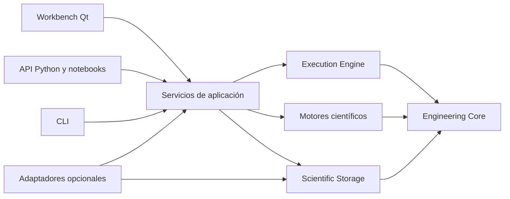

# Arquitectura objetivo

La referencia es un **monolito modular**. Workbench, Python y CLI reutilizan las operaciones de aplicación que ya cuentan con contratos comunes. El objetivo es extender esa frontera a herramientas relacionadas, con evidencia de paridad, sin imponer una reorganización general. [Estado de la arquitectura](../development/architecture.md) · [Auditoría histórica](ARCHITECTURE_AS_IS.md) · [Decisión](ADR-004-INCREMENTAL-ENGINEERING.md)

| Responsabilidad | Base existente | Evolución prevista |
| --- | --- | --- |
| SignalLab Engineering Workbench | Catálogo por disciplinas, variantes, `WorkflowSelector`, resultados, figuras, ayuda y sesiones. | Presentar las mismas solicitudes y resultados con complejidad progresiva. Mantener rutas y restauración de sesiones. |
| Engineering Modules | Servicios de DSP y comunicaciones, y motores originales de señales, filtros y matemática. | Ampliar las familias por dominio. Los motores científicos se prueban con las importaciones de Qt bloqueadas. |
| Engineering Core | `Signal`, `Transfer`, `StateModel`, solicitudes/resultados DFT y DSP, procedencia y contratos I/Q y de reloj. | Diferenciar registro, definición matemática y observación. Versionar los contratos nuevos para distribuciones, espectros, redes, grafos y experimentos solo a medida que se justifiquen. |
| Execution Engine | `ExecutionContext`, guardas de tamaño y memoria, progreso, cancelación cooperativa y workers aislados para cálculo simbólico e importación cuando aplica. | Registrar concurrencia, tiempo, memoria, latencia de cancelación y límites nativos por perfil. Reservar aislamiento para operaciones respaldadas por evidencia. |
| Scientific Storage | `Project` y sesiones, JSON, SLPROJ, SLBIN y campañas con huellas y escrituras atómicas. | Verificar lectura histórica, recuperación y presupuesto. Introducir nuevos esquemas con copia versionada, comprobación de invariantes y posibilidad de volver al original. |
| Python API y CLI | DFT/IDFT, FIR, cambio de tasa, PSD, pipeline DSP y comunicaciones. | Extender paridad y ejemplos reproducibles. Los notebooks consumen la API documentada. |
| Adaptadores externos | Intercambio de archivos y comparadores de auditoría aislados. | Incorporar formatos y dispositivos mediante adaptadores opcionales. El núcleo arranca sin drivers ni instrumentos conectados. |

## Contratos e invariantes

Las solicitudes indican dominio, unidades, reloj, convenciones matemáticas, parámetros, referencias de entrada y recursos necesarios. Las salidas distinguen datos, fórmulas, aproximaciones y condiciones de validez. La procedencia vincula entradas, parámetros normalizados, versión de contrato y resultado. Los experimentos añaden semilla, algoritmo, subflujos y condiciones de reproducción.

Para señales I/Q y redes, conservar fase, frecuencia de referencia e impedancia por puerto según el dominio. Para sistemas, mantener condición inicial, retardos o avances y ROC cuando corresponda. Para grafos, validar puertos, unidades, relojes y ciclos algebraicos antes de ejecutar. La fase que introduzca un contrato acredita equivalencia entre interfaces, cancelación y consistencia de los datos guardados.

## Criterios de cambio

Preferir primitivas compartidas, contratos extensibles y adaptadores dentro del proceso. Un plugin, un servicio distribuido, una interfaz adicional o una dependencia nueva requiere identificar el problema, las alternativas, el impacto en compatibilidad y la evidencia que justifica su coste. Evaluar licencia, mantenimiento, seguridad, precisión, plataformas, memoria, tamaño de los paquetes y superficie nativa. [Catálogo de integración](INTEGRATION_CATALOG.md)

Mantener modelos actuales, formatos históricos, rutas del catálogo y atajos mientras siguen siendo válidos. Una migración científica se ensaya con proyectos reales o fixtures históricos y métodos de referencia. Los cambios relevantes quedan en un ADR con sus condiciones y pruebas. [Validación](VALIDATION_MATRIX.md#criterios-vigentes) · [Política de interfaz](UX_DESIGN_PRINCIPLES.md)
