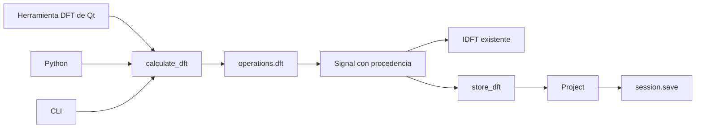

# Informe del piloto DFT de Fase 02

**Fecha de revisión** 25 de noviembre de 2026.

**Candidato** `ce6846bc3e6bc3d56e80bda06eda6edd1e4e2557` en `develop`. Alcance autorizado por ADR-001 después del cierre técnico documentado en `b4fb325`. [Decisión de arquitectura](ADR-001-DFT-PILOT.md) · [Matriz Windows y Ubuntu](https://github.com/Tincho1286/SignalLab-PC/actions/runs/45628542049)

**Dictamen** piloto aprobado en Windows y Ubuntu dentro del alcance de ADR-001. `main` conserva la estable 2.0.0. El resultado queda disponible en `develop` como referencia de trabajo, sin publicación de versión.

## Arquitectura y cambios

Qt prepara `DFTRequest` a partir del formulario y utiliza su worker existente. Los consumidores Python y CLI construyen la misma solicitud. `calculate_dft` aplica `DFTExecution`, llama al motor numérico existente y devuelve `DFTResult`. La interfaz sigue mostrando una `Signal`. La CLI usa el cargador de señales y de sesiones existentes y guarda una sesión de escritorio compatible.

El contrato de ejecución admite un tope estimado de memoria de `128 × N` bytes, plazo monotónico opcional y cancelación cooperativa. La operación comparte la guarda de RAM libre del motor. El resultado conserva reloj, referencia de fase, unidades del eje, origen y longitud efectiva. La procedencia se guarda en los metadatos del espectro. Los identificadores permanecen en las referencias de `Project`, por lo que la fusión de proyectos conserva la traducción de IDs del formato existente.

El espectro y su entrada nueva se preparan juntos y se publican después de validar el cálculo y la procedencia. Antes de publicar se comprueba la cancelación. En la CLI se comprueba otra vez después de sincronizar el archivo temporal y antes de reemplazar el destino. Si vence el plazo antes de ese punto, queda disponible el archivo anterior. Qt usa la referencia a la sesión de origen para descartar una respuesta tardía si el usuario cambió de proyecto.

## Compatibilidad y exactitud

La DFT directa conserva su normalización y la IDFT existente sigue funcionando con bins centrados o sin centrar. Los oráculos evalúan sumas directas y reducen los exponentes con residuos enteros antes de convertirlos a flotantes. La prueba cubre entradas complejas, origen negativo y superior a 2⁶², longitudes pares e impares, truncamiento y relleno con ceros. Qt, Python y CLI arrojaron el mismo espectro y los mismos metadatos para una entrada compleja de cuatro muestras con reloj. La prueba de línea de comandos bloquea cualquier importación de PySide, PyQt, shiboken y qtpy.

Las sesiones de 1.9.3, 1.9.4 y 2.0.0 se abrieron y guardaron con un espectro adicional. Sus registros y controles de escritorio se compararon con los originales. Los espectros históricos conservaron fase, reloj y origen al pasarlos a IDFT. Se mantienen los esquemas de archivo y la opción histórica `record_offset`. [API, convenciones y ejemplos reproducibles](DFT_PILOT_API.md)

Los contratos de cancelación incluyen la finalización del bloque FFT, la entrega de la entrada y del espectro a `Project`, y la escritura de la sesión. Una prueba local complementaria disparó SIGINT después de `fsync` en la CLI. El proceso devolvió 130, conservó los bytes que ya estaban en el destino y eliminó el temporal.

## Verificación en Windows y Linux

| Control sobre el mismo SHA | Windows Server 2022 | Ubuntu 22.04 |
| --- | ---: | ---: |
| Suite integral | 829/829 | 829/829 |
| Casos preventivos | 150/150 | 150/150 |
| Pruebas incorporadas para el piloto | 8/8 | 8/8 |
| Reutilización y controles de escritorio | 318/318 | 318/318 |
| Diagnóstico de los portables descartables | 13/13 | 13/13 |
| Instalador y entrega de prueba | Aprobado | Aprobado |

Los dos jobs registraron la misma huella de código, pruebas y herramientas. La cobertura global de líneas fue de 77,74 % en Windows y 77,71 % en Ubuntu. El objetivo orientativo global de Fase 01 sigue en seguimiento. La matriz de distribución utilizó un manifiesto descartable y los instaladores del candidato. Los ejemplos de la guía de Python y CLI se ejecutaron en un directorio temporal de Windows. [Evidencia de CI](evidence/dft-pilot-ci-ce6846b.json)

## Rendimiento

Medición local con Windows 11, CPython 3.14.10, NumPy 2.5.0 y BLAS/OMP limitados a un hilo. Entrada compleja pseudoaleatoria con semilla `20261125` y origen −7. Se alternó el orden de medición entre motor e interfaz Python. La tabla informa la mediana de 11 repeticiones calientes por caso.

| N | Motor DFT | API del piloto | Memoria de trabajo estimada |
| ---: | ---: | ---: | ---: |
| 1.024 | 0,239 ms | 0,273 ms | 0,125 MiB |
| 65.536 | 4,692 ms | 4,713 ms | 8 MiB |
| 262.144 | 21,257 ms | 22,699 ms | 32 MiB |

Con 65.536 muestras, publicar en `Project` y guardar la sesión tomó 1,90 s, y la CLI completa en un proceso nuevo tomó 4,74 s. Ambos valores son medianas de tres repeticiones. La sesión que contiene la entrada y la DFT ocupó 13.181.821 bytes. El formato JSON domina la latencia observada en este recorrido. El perfil mide tiempos locales y memoria estimada del motor. [Mediciones originales](evidence/dft-pilot-benchmark-ce6846b.json)

Para repetir la comparación caliente, preparar `Signal(rng.normal(size=N)+1j*rng.normal(size=N), -7)` con `numpy.random.default_rng(20261125)` y medir con `time.perf_counter_ns` después de calentar ambas llamadas una vez. Usar `operations.dft(x, centered=True, phase_reference='sample_indices')` y `calculate_dft(DFTRequest(x))`. Para medir persistencia, iniciar un proyecto vacío y guardar la sesión con entrada y salida. Para medir la CLI completa, ejecutar el comando de la guía desde otro proceso sobre el JSON de señal y esperar su salida.

## Riesgos residuales y recomendación

La cancelación y el plazo son cooperativos. La operación comprueba la solicitud al recuperar el control de la FFT nativa. El presupuesto modela memoria de cálculo y deja la carga y la serialización de proyectos grandes bajo las guardas existentes. Un archivo de destino debe tener un único escritor. El inventario de Qt, el DPI de escritorios reales, la confianza de la distribución y el control de cuotas simbólicas siguen el registro de Fase 01. [Riesgos del cierre anterior](RISK_REGISTER.md)

La recomendación es conservar esta frontera para la DFT y usarla para medir flujos más largos y reutilización real de proyectos. La latencia de persistencia merece seguimiento antes de extender el patrón a operaciones de mayor volumen. Cualquier otro piloto requiere autorización y sus propios oráculos. La Fase 03 queda fuera de este trabajo.
