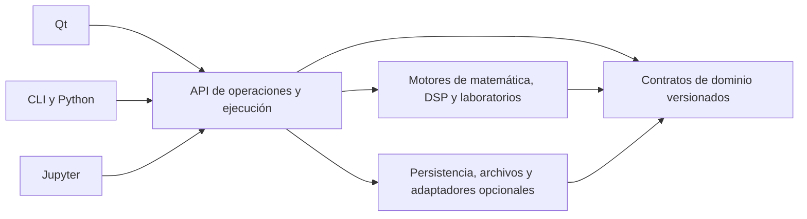

# Hoja de ruta de SignalLab Engineering

La evolución parte del repositorio y los formatos de SignalLab PC. La Fase 00 terminó con autorización condicionada para estabilizar. Cada fase requiere su propia autorización, revisión de riesgos y criterios de salida comprobados. El [estado del proyecto](PROJECT_STATE.md) registra el avance actual.

## Arquitectura objetivo

**Monolito modular propuesto.** La API recibe datos de dominio y un contexto de ejecución explícito. El contexto define cancelación, progreso, presupuesto, semilla y diagnóstico. El resultado lleva dominio, unidades, precisión, condiciones de validez, advertencias y procedencia. Los motores no importan Qt. Los adaptadores traducen al esquema de sesiones existente y a los formatos externos. La interfaz convierte resultados a informes y figuras, y utiliza el mismo registro de operaciones que el consumidor Python.

| Contrato | Reutilización inicial y alcance futuro |
| --- | --- |
| `Signal` y `SymbolicSignal` | Mantener `model.Signal` para registros uniformes. Formalizar expresión, variable, soporte, distribuciones y supuestos a partir de los resultados simbólicos existentes. Diferenciar registro, función y observación. |
| `TransferFunction`, `FilterModel`, `StateSpaceModel` | Usar `filters.Transfer`, sus SOS y `StateModel`. Definir protocolos de evaluación, avance/retardo, condiciones iniciales y ROC. Registrar especificaciones de diseño y tolerancias en `FilterModel`. |
| `IQSignal` y `Spectrum` | Usar datos complejos y semántica espectral actuales, extender con frecuencia central, sentido del espectro, reloj y unidades físicas, escalas de PSD/amplitud, formato de almacenamiento, precisión y segmentos. Evitar redefinir una FFT completa como señal temporal. |
| `ChannelModel` y `RFNetwork` | Definir parámetros, convención de SNR, semilla y reloj para canales. RF necesita puerto, impedancia de referencia, frecuencia y representación S/Z/Y/ABCD con dominios de validez. |
| `ProcessingGraph`, `Experiment` y `Provenance` | Evolucionar el diagrama de realización con puertos tipados y conexiones versionadas. Extender la relación registro/padres con parámetros normalizados, versión del motor, huellas de entradas y salidas y manifiestos de backend. |

Mantener formatos antiguos legibles. Las migraciones crean una copia versionada y validan invariantes antes de reemplazar datos. Preferir adaptadores y contratos extensibles en el mismo proceso. Mantener procesos aislados para cálculo simbólico costoso y componentes externos que lo justifiquen. Documentar alternativas, política de compatibilidad, código de referencia y evidencia con ADR al implementar.

La autorización de Fase 02 se limita a la frontera de la DFT directa definida en ADR-001. El piloto reutiliza el motor, `Signal` y la biblioteca de resultados, y agrega los accesos por Python y CLI. El alcance general propuesto para Fase 02 y las fases posteriores requiere una autorización futura. [ADR 001](ADR-001-DFT-PILOT.md) · [Informe del piloto](PHASE_02_DFT_PILOT.md)

## Secuencia y criterios de salida

La [Fase 02B](phase_02b/README.md) consolida la frontera de aplicación después del piloto DFT. Su plan autorizado cubre IDFT, FIR, resampling, PSD, ejecución secuencial, almacenamiento, recursos, API y validación. La preparación de Fase 03 se evalúa en el cierre.

| Fase | Alcance | Salida comprobable |
| --- | --- | --- |
| 00 · Auditoría | Estado real, arquitectura, matemática, CI, dependencias, deuda y riesgos. | Informes revisados, evidencia ligada al commit y procedimientos de reproducción para las comprobaciones pendientes. |
| 01 · Estabilización | Resolver regresiones prioritarias. Consolidar pruebas, sesiones, recursos, revisión de dependencias y empaquetado. | Línea base limpia, tests y oráculos independientes en Windows/Linux, instalación y actualización verificadas con manifiestos y regresiones de sesiones. |
| 02 · Core | Contratos de dominio, ejecución y procedencia. Primera operación reutilizada desde Qt, API Python y CLI. Jupyter consume API Python. | Los resultados coinciden por interfaz y el motor puede ejecutarse sin Qt. Migración de formatos probada y ADR aprobados. |
| 03 · Comunicaciones | Generar símbolos, mapear BPSK/QPSK y demás M-PSK, QAM, ASK/FSK/PAM, OFDM, Gray, filtros Raised Cosine y RRC, diagramas de ojo/constelación, BER/SER/EVM y sincronización. | Demostrador QPSK + RRC + AWGN + filtro adaptado + demodulación + BER/EVM. Energía y ganancia calibradas. BER teórica y simulada compatibles por intervalo binomial, EVM con tolerancia analítica y semilla reproducible. |
| 04 · Canales | Ampliar el AWGN del demostrador con Rayleigh, Rician, multitrayecto, Doppler, offsets, interferencia, I/Q y canales FIR/variantes. | Se documentan SNR, energía por bit/símbolo, potencia, reloj y semillas. Pruebas de casos sin deterioro, límites e identidades por canal. |
| 05 · SDR y espectro | SigMF, I/Q binario, FFT/PSD/STFT, waterfall, DDC/DUC, NCO, CIC, half-band, resampling y flujo por bloques. | Intercambio SigMF verificado y equivalencia entre ejecutar por bloques y sobre un registro pequeño completo. Límites medidos de memoria, fase y frecuencia. |
| 06 · RF | Touchstone, redes y conversiones, Smith, impedancia, VSWR, pérdidas, retardo, cascada, adaptación y síntesis de filtros. | Referencias independientes de redes simples y pruebas por puerto con impedancia de referencia explícita. |
| 07 · Punto fijo y FPGA | Formatos Q, palabra/fracción, redondeo, saturación/wraparound, acumuladores, sensibilidad, exportación y vectores. | Vectores bit a bit contra referencia bajo modo y escala documentados. Comparación con flotante sin perder los casos especiales. |
| 08 · Simulación de sistemas | Evolución del editor a grafos con puertos tipados, relojes, multitasa y bloques LTI/no lineales/variantes. | Detectar ciclos algebraicos, errores de unidades y relojes incompatibles. Guardar y volver a ejecutar con la misma semilla y tolerancia. |
| 09 · Plataforma integrada | Plugins opcionales, SoapySDR, RTL-SDR, PlutoSDR, USRP, SCPI/PyVISA, instrumentos de RF, reportes y notebooks. | Smoke sin hardware, pruebas en dispositivos representativos y documentación de los límites. El núcleo no necesita drivers ni GNU Radio para iniciar. |

La primera validación de AWGN se necesita en Fase 03 para el demostrador. La Fase 04 amplía el mismo contrato y su implementación. Las dependencias recomendadas para pruebas de concepto y sus condicionantes están en [DEPENDENCY_AUDIT](DEPENDENCY_AUDIT.md).

La [Fase 02C](phase_02c/README.md) evalúa la solidez del Core antes de ese cambio de alcance. Sus condiciones de salida incluyen procedencia demostrada, recursos medidos, auditoría científica y de dependencias, compatibilidad, cobertura y excepciones explícitas.
