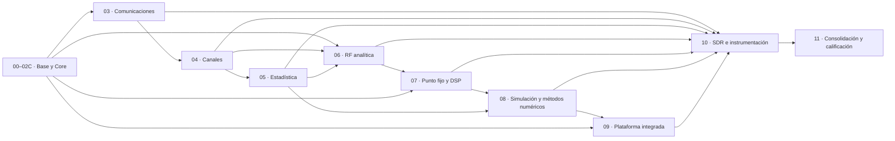

# Hoja de ruta de SignalLab Engineering

SignalLab amplía sus dominios científicos y moderniza las herramientas de señales, sistemas, filtros, muestreo, estadística y cálculo que ya usa el público. Cada fase futura define su alcance verificable a partir de una auditoría propia y requiere autorización de inicio. Las familias de versiones orientan la planificación. [Visión](VISION.md) · [Estado del proyecto](PROJECT_STATE.md) · [Política de entregas](RELEASE_POLICY.md)

| Fase | Denominación oficial | Familia |
| --- | --- | --- |
| 00 | Engineering Audit | Histórica |
| 01 | Stabilization | Histórica |
| 02A | Engineering Core Pilot | Histórica |
| 02B | Engineering Core Consolidation | Histórica |
| 02C | Core Hardening & Quality Gate | Histórica |
| 03 | Digital Communications Lab | 2.1.x |
| 04 | Channel Modeling | 2.2.x |
| 05 | Probability, Statistics & Stochastic Processes | 2.3.x |
| 06 | RF & Microwave | 2.4.x |
| 07 | Fixed-Point & Embedded DSP | 2.5.x |
| 08 | System Simulation & Numerical Engineering | 2.6.x |
| 09 | Integrated Engineering Platform | 2.7.x |
| 10 | SDR & Experimental Engineering | 2.8.x |
| 11 | Final Engineering Consolidation & Qualification | Por determinar |

La Fase 02A corresponde al piloto DFT que el expediente histórico identifica como Fase 02. Las fases 03, 04 y 05 están cerradas e integradas. Stable/LTS 2.0.x conserva su línea de mantenimiento desde `v2.0.0`. [Piloto DFT](PHASE_02_DFT_PILOT.md) · [Cierre de Fase 02C](phase_02c/validation/QUALITY_GATE_REPORT.md) · [Cierre de Fase 03](phase_03/PHASE_03_CLOSEOUT.md) · [Cierre de Fase 04](phase_04/PHASE_04_CLOSEOUT.md) · [Cierre de Fase 05](phase_05/PHASE_05_INTEGRATION.md)

La Fase 06 está calificada en 2.4.0 Preview. La aceptación funcional y la integración en `main` siguen pendientes. Las fases 07 a 11 mantienen su alcance estratégico sujeto a autorización. [Entrega de Fase 06](phase_06/PHASE_06_CLOSEOUT.md) Los requisitos, la implementación y la calificación de cada fase comienzan con su autorización específica. Las fases cerradas conservan su evidencia. Una regresión concreta se trata en el ciclo de corrección que corresponda. [Dictamen](STRATEGIC_REVIEW_POST_PHASE_05.md#dictamen-de-preparación-para-fase-06)

## Dependencias científicas entre fases

| Fase receptora | Activos que reutiliza | Condición para compartirlos |
| --- | --- | --- |
| 06 · RF | Ejes y frecuencia del Core, `Transfer`, PSD/ventanas, pérdida de propagación, potencias de comunicaciones e incertidumbre de Fase 05. | Conservar unidades y reloj. Definir ondas, puertos e impedancias de referencia en un contrato de red. |
| 07 · Punto fijo | Muestreo, `Encoding`, aritmética, FIR/SOS, cambio de tasa y medidas de filtros y espectros. | Declarar reglas de bits, acumulador y estados. Acreditar los resultados contra vectores enteros independientes. |
| 08 · Simulación | `StateModel`, realizaciones, CAS, reloj, operadores lineales, estimación y análisis por fases. | Conservar supuestos, puertos y condiciones al extender los modelos. Medir convergencia, estabilidad y condicionamiento. |
| 09 · Plataforma | Proyectos, biblioteca, ejecución y procedencia desde Core, y experimentos y contratos de las disciplinas implementadas. | Reusar identidades y hechos de procedencia. Validar lectura histórica y proyectos multidisciplinarios. |
| 10 · SDR | RF, I/Q, pulso, reloj, canales, PSD, estadística, DSP por bloques, punto fijo y simulación. | El núcleo permanece funcional sin hardware. La compatibilidad depende de las combinaciones de dispositivos y plataformas ensayadas. |
| 11 · Calificación | Contratos, oráculos, pruebas, pilotos de rendimiento, almacenamiento y distribución desde 00–10. | Consolidar y reacreditar el alcance implementado con los objetivos terminales y evidencia verificable. |

[Referencias y modalidades](INTEGRATION_CATALOG.md) · [Capacidades actuales](SCIENTIFIC_ENGINE_INVENTORY.md)

## Cómo se define una fase

Al comenzar una fase autorizada, contrastar cada propuesta con el catálogo, los motores y las pruebas existentes. Registrar las limitaciones, requisitos, oráculos y presupuestos antes de implementar. Priorizar la ampliación de las herramientas relacionadas, la conexión con Engineering Core y las regresiones que prueban su uso original. Los cambios sustanciales de alcance requieren aprobación del propietario. [Plan de modernización](TOOL_MODERNIZATION_PLAN.md) · [Arquitectura objetivo](ARCHITECTURE_TO_BE.md) · [Validación](VALIDATION_MATRIX.md#criterios-vigentes)

## Fase 05 · Probabilidad, estadística y procesos estocásticos

La fase está cerrada. Estos objetivos guiaron el desarrollo de la base probabilística reutilizable y el piloto de complejidad progresiva. El inventario posterior describe el alcance efectivo de cada método. [Herramientas de señales aleatorias](TOOL_INVENTORY.md#señales-aleatorias--8)

- **Probabilidad.** Distribuciones continuas, discretas, multivariadas y complejas. PDF, PMF, CDF, CCDF, cuantiles, momentos, distribuciones conjuntas, marginales y condicionales, generación correlacionada y matrices de covarianza. Evaluar uniforme, Bernoulli, binomial, Poisson, geométrica, normal real y compleja, exponencial, gamma, beta, Rayleigh, Rician, Nakagami, Weibull, lognormal, χ², Student t, F, Laplace y Cauchy.
- **Inferencia.** Estadística descriptiva y momentos superiores, asimetría, curtosis, intervalos de confianza, máxima verosimilitud, método de momentos, ajuste, pruebas de hipótesis y de bondad de ajuste. Ampliar el histograma con CDF empírica, Q-Q y boxplots.
- **Procesos.** Ruido blanco real y complejo, coloreado, impulsivo o con PSD dada. Procesos gaussianos, caminatas aleatorias, Wiener, Poisson, Markov, Ornstein–Uhlenbeck y telegráfico. Distinguir correlación y covarianza teóricas y experimentales, estacionariedad y ergodicidad.
- **Identificación.** Ampliar AR, MA y ARMA con ARIMA y evaluar Yule–Walker, Burg, mínimos cuadrados y máxima verosimilitud. Revisar ACF/PACF, elección de orden, AIC/AICc/BIC, residuos, estacionariedad, invertibilidad y pronóstico con incertidumbre.
- **Espectros.** Ampliar periodograma, Welch y PSD AR. Evaluar Bartlett, Blackman–Tukey, multitaper, Lomb–Scargle, espectro cruzado, coherencia, intervalos y comparación entre métodos.
- **Estimación y filtrado óptimo.** Evaluar ML, MAP, MMSE, LMMSE, Wiener, Kalman, LMS, NLMS y RLS. Reutilizar convenciones de estados, relojes y observación.
- **Monte Carlo.** Generalizar réplicas, semillas y subflujos, convergencia, bootstrap, incertidumbre, sensibilidad, estimación de probabilidades y comparación de modelos.

**Salida acreditada.** 2.3.1 quedó aceptada e integrada. Los cinco demostradores y la matriz acumulativa acreditaron el alcance ejecutado en Windows y Ubuntu. Los límites de cada familia, incluidos los intervalos Bartlett y el Kalman lineal discreto, permanecen documentados. [Modernización de Fase 05](TOOL_MODERNIZATION_PLAN.md#fase-05--probabilidad-y-estadística) · [Cierre](phase_05/PHASE_05_INTEGRATION.md)

## Fase 06 · RF y microondas

- **Redes y líneas.** Parámetros S, Z, Y y ABCD, redes multipuerto e intercambio Touchstone. Carta de Smith, impedancias y admitancias, reflexión, VSWR, pérdidas de retorno e inserción, líneas de transmisión, adaptación, cascadas, retardo de grupo y filtros RF.
- **Enlace y dispositivos.** Presupuesto de enlace, figura de ruido, sensibilidad y modelos analíticos de compresión e intermodulación.
- **Herramientas originales.** Ampliar el diseñador analógico con Bessel y familias complementarias. Reutilizar transferencia, respuesta frecuencial y retardo de grupo. Extender el análisis con chirp-Z, Zoom FFT, detección e interpolación de picos y ventanas Tukey, Flat top, Nuttall, DPSS y Dolph–Chebyshev. Conservar las medidas de ENBW, ganancia coherente y pérdida entre bins, e incorporar sensibilidad paramétrica.

**Salida estratégica.** Contrastar redes de referencia, conversiones, impedancias de puerto, adaptación e intercambio Touchstone con fórmulas analíticas y comparadores independientes. Evaluar scikit-rf, SciPy y una referencia de circuito externa. Acreditar cálculo, importación, guardado y validación sin hardware RF. [Plan de Fase 06](TOOL_MODERNIZATION_PLAN.md#fase-06--rf-y-microondas) · [Evaluación de referencias](INTEGRATION_CATALOG.md#referencias-y-modalidades-de-integración)

**Estado de entrega.** La Preview acredita redes, líneas, adaptación, Bessel, enlace, espectros e interoperabilidad sin hardware. Los límites de modelos y formatos acompañan el expediente. [Quality Gate](phase_06/QUALITY_GATE_REPORT.md) · [Límites](phase_06/TECHNICAL_DEBT_REGISTER.md)

## Fase 07 · Punto fijo y DSP embebido

- **Aritmética y realización.** Ampliar los formatos Q, longitud de palabra y fracción, redondeo, truncamiento, saturación, wraparound, acumuladores, sensibilidad, propagación de errores y ciclos límite. Evaluar estructuras, filtros CIC y half-band, procesamiento polifásico, conversión multietapa y exportación de coeficientes y vectores para modelos embebidos y FPGA.
- **Filtros digitales.** Evaluar Parks–McClellan/Remez, equiripple, mínimos cuadrados, diferenciadores, Hilbert, notch, resonadores, comb, optimización SOS, comparación de realizaciones, sensibilidad, Savitzky–Golay y mediana.
- **Muestreo y A/D.** Ampliar la cuantización y reconstrucción con modelos ADC/DAC, jitter, DNL/INL, offset, ganancia, apertura, retenedor, saturación y clipping. Evaluar ENOB, SINAD, SFDR, THD, THD+N, SNR, dither, sobremuestreo, noise shaping, sigma-delta, interpolación avanzada, muestreo no uniforme y conversión racional multietapa.

**Salida estratégica.** Verificar vectores bit a bit ante una referencia independiente. Comparar con coma flotante y medir el error por formato, estructura y etapa. [Plan de Fase 07](TOOL_MODERNIZATION_PLAN.md#fase-07--punto-fijo-y-dsp-embebido)

## Fase 08 · Simulación de sistemas e ingeniería numérica

- **Simulación.** Evolucionar los diagramas hacia grafos con puertos tipados, relojes, unidades, estado inicial y detección de ciclos algebraicos. Evaluar sistemas continuos, discretos, lineales, no lineales, variantes en el tiempo y multitasa.
- **Sistemas LTI.** Revisar Nyquist, Nichols, lugar de raíces, estabilidad relativa, sensibilidad y robustez. Ampliar tiempo de subida, establecimiento, sobreimpulso, error estacionario y comparación de sistemas. Reutilizar espacio de estados, controlabilidad y observabilidad al evaluar realizaciones mínimas, formas canónicas, reducción de orden, asignación de polos, observadores, LQR y MIMO por valores singulares.
- **Matemática y CAS.** Evaluar SVD, QR, LU, Cholesky, pseudoinversa y condicionamiento. Ampliar cálculo con gradiente, Jacobiano, Hessiano e integrales múltiples. Revisar bisección, secante, Newton–Raphson y sistemas no lineales, diferencias finitas, Richardson, trapecios, Simpson, cuadratura gaussiana y adaptativa, interpolación de Lagrange, Newton y splines, mínimos cuadrados y optimización con restricciones.
- **Ecuaciones.** Evaluar Euler, Heun, Runge–Kutta y métodos adaptativos para EDO individuales o en sistemas, con estabilidad, convergencia y control de error. Delimitar el alcance de las EDP básicas de calor, onda, Laplace y Poisson. Las EDP avanzadas y la optimización especializada requieren una evaluación de utilidad y coste.
- **Laplace y Z.** Ampliar inversión numérica, evaluación compleja, sensibilidad, fracciones parciales, visualización de ROC, singularidades, verificación de validez y comparación simbólica y numérica.

**Salida estratégica.** Probar simulaciones reproducibles, convergencia contra soluciones independientes y consistencia de unidades y relojes. El editor de realización evoluciona por casos verificados. Cualquier editor general exige justificación arquitectónica. [Plan de Fase 08](TOOL_MODERNIZATION_PLAN.md#fase-08--simulación-y-métodos-numéricos)

## Fase 09 · Plataforma integrada

- **Proyectos y experimentos.** Organización de señales, modelos y corridas, flujos reutilizables, automatización con Python y CLI, notebooks, informes, exportación, barridos, comparación, recuperación, reanudación, procedencia, interoperabilidad y biblioteca de fundamentos y ejemplos.
- **Workbench.** Homogeneizar interacción, unidades, convenciones, metadatos e intercambio de resultados. Ampliar el acceso por búsqueda, favoritos y herramientas recientes. Integrar motores pendientes en Engineering Core y resolver redundancias entre disciplinas.
- **Límites.** Mantener Qt y evolucionar el Workbench por mejoras verificadas. Los adaptadores externos son opcionales. Los sistemas generales de plugins, arquitecturas distribuidas, interfaces web y rediseños generales requieren una necesidad demostrada y aprobación de alcance.

**Salida estratégica.** Guardar, reproducir, automatizar, comparar y documentar un proyecto multidisciplinario con sus datos y metadatos científicos intactos. [Plan de Fase 09](TOOL_MODERNIZATION_PLAN.md#fase-09--plataforma-integrada)

## Fase 10 · SDR e ingeniería experimental

Es la última fase de expansión funcional. Reutiliza comunicaciones, canales, estadística, RF, punto fijo y simulación para comparar modelos y mediciones.

- **Adquisición y procesamiento.** Evaluar RTL-SDR, PlutoSDR, USRP y SoapySDR. Capturar, guardar y reproducir I/Q en SigMF y binario. Ampliar FFT, PSD, STFT, waterfall, DDC/DUC, NCO y procesamiento por bloques para flujos continuos.
- **Instrumentación.** Evaluar SCPI y PyVISA para instrumentos compatibles. Publicar el alcance por combinación de dispositivo, driver y plataforma que tenga evidencia. El núcleo y el Workbench funcionan sin dispositivos ni drivers SDR.
- **Señales.** Ampliar chirps lineales, exponenciales y cuadráticos, multitono, pulsos gaussianos, PRBS, MLS, I/Q, ráfagas, trenes y retardos fraccionarios. Reutilizar medidas de registros para tendencia, componente DC, normalización por energía/potencia/amplitud, PAPR, factor de cresta, picos y cruces por cero. Medir el funcionamiento con registros extensos.
- **Tiempo-frecuencia.** Conservar la STFT inversa y ampliar análisis, síntesis y reconstrucción. Evaluar wavelets continuas y discretas, escalogramas, análisis multirresolución y eliminación de ruido.

**Salida estratégica.** Acreditar adquisición reproducible, intercambio SigMF, equivalencia entre registros completos y procesamiento por bloques, presupuestos medidos y pruebas en hardware representativo. [Plan de Fase 10](TOOL_MODERNIZATION_PLAN.md#fase-10--sdr-e-instrumentación)

## Fase 11 · Consolidación y calificación definitiva

Aplica el enfoque de Fase 02C a toda la plataforma. Su alcance se limita a consolidar, optimizar y calificar las capacidades ya desarrolladas para mantenimiento a largo plazo. Cada fase anterior sigue siendo responsable de resolver la deuda que le corresponda o elevar una excepción explícita.

| Paquete | Alcance |
| --- | --- |
| WP-00 | Integral Audit & Baseline |
| WP-01 | Architectural Consolidation |
| WP-02 | Scientific & Mathematical Qualification |
| WP-03 | Coverage & Testing Hardening |
| WP-04 | Performance & Resource Optimization |
| WP-05 | Security & Dependency Hardening |
| WP-06 | Workbench & UX Consolidation |
| WP-07 | Storage & Interoperability Qualification |
| WP-08 | Documentation & Maintainability |
| WP-09 | Distribution & Release Qualification |
| WP-10 | Final Quality Gate & Project Closeout |

| Métrica | Umbral mínimo |
| --- | ---: |
| Líneas globales | 99 % |
| Ramas globales | 99 % |
| Funciones globales | 99 % |
| Líneas de componentes críticos | 99 % |
| Ramas de componentes críticos | 99 % |

Antes de medir, fijar el universo de código, inventario de funciones, denominadores, exclusiones justificadas y reconciliación entre plataformas. Medir entradas que ejecuten cada función instrumentada. Conservar pruebas con resultados observables, oráculos y casos de error. [Protocolo de calificación](VALIDATION_MATRIX.md#calificación-de-fase-11)

La calificación reúne arquitectura, matemática, pruebas unitarias, integración, end-to-end, propiedades, diferenciales, mutación cuando corresponda, fuzz seguro y estrés prolongado. También verifica seguridad, rendimiento, recursos, compatibilidad, integridad, recuperación, interoperabilidad, empaquetado, distribución, documentación y mantenimiento.

El cierre emite cinco dictámenes independientes sobre calificación técnica, calificación científica, distribución definitiva, mantenimiento a largo plazo y cierre estratégico. El nombre y la numeración de esa versión requieren autorización específica.
