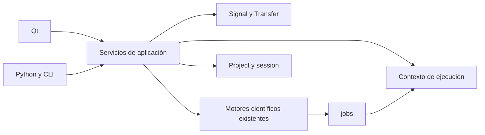

# Engineering Core

La UI prepara datos y presenta resultados. La aplicación define contratos y coordina la ejecución. El dominio conserva modelos y unidades. Project y session controlan identidad y persistencia. Los motores conservan algoritmos y convenciones.
