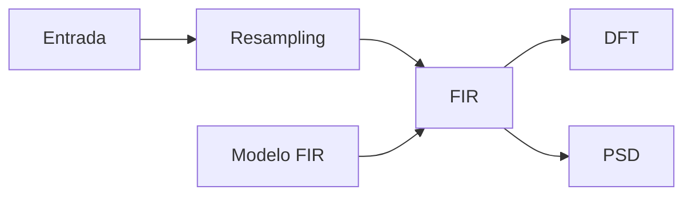

# Arquitectura del demostrador DSP

**Criterio de salida.** Python y CLI producen el mismo flujo sin Qt. Los cuatro resultados tienen padres y se reutilizan. Una etapa rechazada o cancelada conserva el proyecto previo.

Se eligió una secuencia tipada fija. Representar un grafo genérico añadiría planificación y configuración sin un segundo flujo que justifique esos contratos. La GUI usa sus herramientas existentes en ese orden.
