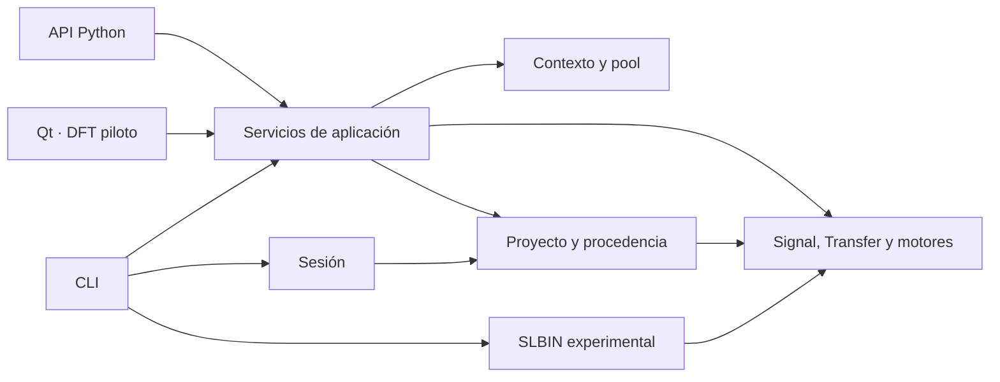

# Dependencias del Core

El grafo directo y transitivo se obtuvo del AST de los módulos incluidos. La prueba de importación ejecutó once entradas con un `MetaPathFinder` que rechaza las familias Qt. La ejecución agregó los seis registros esperados en un proyecto nuevo.
